# Enlace RS485 ESP32–Portenta y modo Automático V2 (versión V4)

Documento técnico de apoyo para el trabajo escrito. Describe la capa física del
enlace RS485, el protocolo de comunicación diseñado sobre ella, todas las
funciones del firmware vigente, el funcionamiento del modo **Automático V2** y
los cambios introducidos hasta la última versión del código (V4).

**Fuentes analizadas** (carpeta `V4/automatico v2 rs485/`):

| Archivo | Placa | Contenido |
|---|---|---|
| `ESP/ESP.ino` | ESP32 | Firmware de la ESP32 (4951 líneas) |
| `PORTENTA/PORTENTA.ino` | Portenta H7 + Machine Control | Firmware coordinador (6567 líneas) |
| `ESP/EnlaceRS485.h`, `PORTENTA/EnlaceRS485.h` | ambas (copias idénticas) | Capa de transporte RS485 |
| `ESP/ProtocoloRS485.h`, `PORTENTA/ProtocoloRS485.h` | ambas (copias idénticas) | Capa de aplicación (paquetes de 32 bytes) |
| `ESP/ConfiguracionRS485.h` | ESP32 | Pines RS485 |
| `PORTENTA/RecuperacionEnlace.h` | Portenta | Política de pérdida de enlace (1000 ms) |
| `PORTENTA/CapturaFijaV2.h` | Portenta | Estimador de velocidad/aceleración y predicción del contacto |
| `PORTENTA/AjusteTemporalCapturaV2.h` | Portenta | Comando `CATCH` (desfase temporal) |
| `PORTENTA/AjusteCatchV2.h` | Portenta | Búsqueda del ajuste del catch con etiquetas del operador |
| `ESP/CalibracionAnguloMLV2.h`, `PORTENTA/CalibracionAnguloMLV2.h` | ambas (copias idénticas) | Giro de la garra a partir de la caja de la cámara |
| `ESP/VisionModelo129.h` | ESP32 | Clases admitidas del modelo 129 de la HUSKYLENS 2 |

Entorno de compilación: ESP32 con el core `esp32-bluepad32:esp32:esp32` 4.1.0;
Portenta H7 (núcleo M7) con `arduino:mbed_portenta:envie_m7` 4.6.0. Bibliotecas
relevantes: `Arduino_MachineControl` 1.1.2, `ArduinoRS485` 1.1.1,
`DFRobot_HuskylensV2` 1.0.9, `Bluepad32`, `ESP32Servo` 3.2.1 y
`Adafruit_SH110X`. Monitor serie: ESP32 a 460800 baudios, Portenta a 115200.
El bus RS485 trabaja siempre a 115200 baudios, independiente de los monitores.

> **Nota sobre el alcance.** El repositorio no tiene historial de commits
> utilizable para V4; los cambios de la última versión se obtuvieron
> comparando archivo por archivo `V3/automatico v2 rs485/` (respaldo) con
> `V4/automatico v2 rs485/` (copia de trabajo) y con la documentación
> de desarrollo (`README_RS485.md`, `CAPTURA_FIJA_V2.md`,
> `DIAGNOSTICO_RS485_2026-10-08.md`). Donde el código y esa documentación no
> coinciden, manda el código; las diferencias se listan en la sección 8.

---

## Índice

1. [Arquitectura general del sistema](#1-arquitectura-general-del-sistema)
2. [Antecedente: enlace I2C y motivo de la migración](#2-antecedente-enlace-i2c-y-motivo-de-la-migración)
3. [Capa física RS485](#3-capa-física-rs485)
4. [Protocolo de comunicación](#4-protocolo-de-comunicación)
5. [Funciones del firmware](#5-funciones-del-firmware)
6. [Modo Automático V2](#6-modo-automático-v2)
7. [Cambios hasta la última versión (V4)](#7-cambios-hasta-la-última-versión-v4)
8. [Diferencias detectadas entre código y documentación](#8-diferencias-detectadas-entre-código-y-documentación)
9. [Estado de verificación y pendientes](#9-estado-de-verificación-y-pendientes)

---

## 1. Arquitectura general del sistema

El brazo cartesiano se controla con dos microcontroladores que se reparten las
tareas:

- **Arduino Portenta H7 sobre Portenta Machine Control (coordinador / maestro).**
  Genera los pulsos STEP/DIR de los tres motores paso a paso (X, Y, Z), lee
  los seis finales de carrera, lee el encoder de la banda transportadora, ejecuta
  la máquina de estados general (arranque, calibraciones, menú y modos) y
  decide todos los movimientos. Es el **maestro** del bus RS485.
- **ESP32 (periférico / esclavo).** Se conecta al control inalámbrico
  (Bluepad32), mueve los dos servos (giro de la garra y pinza), maneja la
  cámara **HUSKYLENS 2** (calibración por *tags* y detección de piezas con el
  modelo personalizado 129), dibuja la pantalla OLED y publica a la Portenta
  el estado del control, de los servos, de la cámara y las piezas detectadas.
  Es el **esclavo** del bus RS485: solo transmite cuando responde a una
  solicitud de la Portenta.

Buses y conexiones de cada placa:

```text
                         +------------------------------------------+
   Control BT  ))))))))  |                  ESP32                   |
   (Bluepad32)           |  UART1 RX32/TX33 115200 ---- HUSKYLENS 2  |
                         |  I2C1 SDA21/SCL22 100 kHz -- OLED SH1106 |
                         |  GPIO25 ------------------- Servo giro   |
                         |  GPIO26 ------------------- Servo pinza  |
                         |  UART2 TX27 / RX14 / DE18                |
                         +-------------------|----------------------+
                                             | 3,3 V (TTL)
                                  +----------v----------+
                                  | Convertidor de nivel |  3,3 V <-> 5 V
                                  +----------|----------+
                                             | 5 V (TTL)
                                  +----------v----------+
                                  |   Módulo MAX485     |  DI, RO, DE=/RE
                                  +----------|----------+
                                             | Par diferencial A/B (RS-485, half duplex)
                         +-------------------v----------------------+
                         |  Portenta Machine Control: RS485 TX P/N   |
                         |  Portenta H7 (M7)                         |
                         |  Salidas digitales 0..5 ---- STEP/DIR X,Y,Z|
                         |  DIN00..DIN05 -------------- finales NC    |
                         |  Encoder canal 0 (A0/B0/Z0)- encoder banda |
                         |  I2C interno (Wire) -------- expansor DIN  |
                         +------------------------------------------+
```

Asignaciones relevantes en la Machine Control (`PORTENTA.ino`):

| Recurso | Uso |
|---|---|
| Salidas digitales 4/5 | STEP/DIR de X |
| Salidas digitales 2/3 | STEP/DIR de Y |
| Salidas digitales 0/1 | STEP/DIR de Z (driver Z con sentido invertido) |
| DIN00 / DIN01 | Final X− / X+ (lógica NC: abierto = activo) |
| DIN02 / DIN03 | Final Y− / Y+ |
| DIN04 / DIN05 | Final Z abajo / Z arriba |
| Encoder 0 | Omron E6B2-CWZ6C, 1024 P/R, decodificación X2 (2048 cuentas/vuelta), rueda de 49 mm → 0,07517 mm/cuenta |
| Ticker `motorTicker` | Interrupción cada 100 µs para generar los pulsos STEP (≈5000 pasos/s con divisor 1) |

La pantalla OLED **sigue usando I2C** (bus independiente de la ESP32). Lo que
se migró a RS485 es únicamente el enlace de control ESP32 ↔ Portenta.

---

## 2. Antecedente: enlace I2C y motivo de la migración

Antes de la migración (carpeta `V3/pruebas de automatico v2/`), la ESP32 era
**esclava I2C** de la Portenta:

| Parámetro | Enlace I2C anterior |
|---|---|
| Dirección de la ESP32 | `0x40` |
| Pines de la ESP32 | SDA = GPIO27, SCL = GPIO14 |
| Mecanismo | `Wire.onReceive()` / `Wire.onRequest()` (interrupciones de la biblioteca Wire) |
| Paquetes | Los mismos 32 bytes de aplicación (límite del búfer de Wire, `MAX_BYTES_WIRE = 32`) |
| Versión de protocolo | 16 y luego 18 |

Por instrucción del usuario (registrada el 2026-10-09 en `README_RS485.md`), el
desarrollo vigente del enlace ESP–Portenta es **exclusivamente RS485**; la
variante I2C queda como antecedente sin nuevas mejoras.

Justificación técnica general (para el trabajo escrito; no es una medición del
proyecto): I2C es un bus de terminación simple pensado para distancias cortas
dentro de una placa, con líneas de colector abierto y resistencias de *pull-up*,
por lo que es sensible a la capacitancia del cable y al ruido inducido. RS-485
transmite de forma **diferencial** sobre un par trenzado, rechaza el ruido de
modo común (motores paso a paso, variador de la banda) y admite tramos largos.

Diferencia importante para el diseño del protocolo: en I2C el propio hardware
entrega delimitación de mensajes (condiciones START/STOP), direccionamiento y
acuse por byte (ACK). Una UART sobre RS-485 entrega solo un **flujo de bytes**,
sin inicio ni fin de mensaje, sin control de errores y sin arbitraje del medio.
Por eso la migración conservó la capa de aplicación (los mismos paquetes de 32
bytes) y **agregó una capa de transporte** propia que resuelve:
delimitación (COBS), integridad (CRC16), correlación solicitud-respuesta
(sesión + número de solicitud) y gestión de turnos en *half duplex*.

---

## 3. Capa física RS485

### 3.1 Estándar utilizado

Se usa **RS-485 (TIA/EIA-485-A)** en modo **half duplex de dos hilos**: un único
par diferencial (A/B) compartido para transmitir en ambos sentidos, de modo que
en cada instante solo un transmisor puede estar habilitado. Características
generales del estándar: señal diferencial, umbral del receptor de ±200 mV, rango
de modo común de −7 V a +12 V, hasta 32 cargas unitarias por bus, cable de par
trenzado de impedancia característica ≈120 Ω y terminación en los extremos.

Sobre ese medio corre una **UART asíncrona a 115200 baudios, formato 8N1**
(1 bit de inicio, 8 de datos, sin paridad, 1 de parada → 10 bits por byte):

| Magnitud | Valor |
|---|---|
| Duración de un bit | 8,68 µs |
| Duración de un byte (10 bits) | 86,8 µs |
| Trama completa en el cable (44 bytes) | 440 bits → **3,82 ms** |
| `TIEMPO_TRAMA_MS` (redondeo hacia arriba en el código) | 4 ms |

### 3.2 Componentes

| Componente | Función | Configuración |
|---|---|---|
| **ESP32**, UART2 (`HardwareSerial PuertoRS485(2)`) | Puerto serie del esclavo | TX = GPIO27, RX = GPIO14, dirección (DE//RE) = GPIO18 (`ConfiguracionRS485.h`); búfer RX de 256 bytes |
| **Convertidor de nivel bidireccional** (p. ej. TXS0108E) | Adapta 3,3 V (ESP32) ↔ 5 V (MAX485) en las tres señales DI, RO y DE//RE | Lado A/VCCA = 3,3 V de la ESP32; lado B/VCCB = 5 V regulados; OE a 3,3 V si es TXS0108E |
| **Módulo MAX485** | Transceptor TTL ↔ RS-485 half duplex del lado ESP32 | VCC = 5 V regulados; DE y /RE puenteados y controlados por GPIO18; incluye resistencia de terminación de 120 Ω (R7 marcada `121`, a confirmar en la unidad física) |
| **Portenta Machine Control** | Transceptor RS-485 integrado, configurable por software (RS232/RS422/RS485) | `comm_protocols.rs485`, modo RS485 *half duplex*, terminación interna **desactivada**, `begin(115200, 0, 2000)` |
| **Par trenzado A/B** | Medio físico diferencial | Separado del cableado de motores y del variador; GND llevado aparte |

**Por qué hace falta el convertidor de nivel.** El MAX485 se alimenta a 5 V y su
salida RO entrega niveles lógicos de 5 V; los GPIO de la ESP32 admiten como
máximo ≈3,6 V. RO nunca se conecta directo a GPIO14: pasa por el convertidor.
Las entradas DI, DE y /RE del MAX485 aceptan 3,3 V como nivel alto, pero el
montaje que funcionó las pasa también por el convertidor y se conservó así.

### 3.3 Cableado

Lado lógico (ESP32 → convertidor → MAX485):

| ESP32 | Convertidor de nivel | MAX485 |
|---|---|---|
| GPIO27 (TX de UART2) | Canal usado en la prueba funcional para DI | DI (entrada del transmisor) |
| GPIO14 (RX de UART2) | Canal usado en la prueba funcional para RO | RO (salida del receptor) |
| GPIO18 (dirección) | Canal usado en la prueba funcional para dirección | DE y /RE unidos |
| GND | GND | GND |

Alimentación:

| Punto | Conexión |
|---|---|
| VA/VCCA del convertidor | 3,3 V de la ESP32 |
| VB/VCCB del convertidor | 5 V regulados |
| OE (si es TXS0108E) | 3,3 V |
| VCC del MAX485 | 5 V regulados (nunca 3,3 V ni 24 V) |
| GND | Común entre ESP32, convertidor, MAX485 y GND de comunicaciones de la Machine Control |

Lado diferencial (MAX485 → Machine Control):

| MAX485 | Borne de la Machine Control |
|---|---|
| A | RS485 **TX P** (Data+) |
| B | RS485 **TX N** (Data−) |
| GND | GND de comunicaciones |

En *half duplex* los bornes **RX P y RX N de la Machine Control quedan libres**:
el par TX se usa en ambos sentidos (`rs485FullDuplex(false)`). Los GPIO27/14
reutilizan los pines del antiguo I2C (antes SDA/SCL), por lo que hubo que retirar
el cableado I2C hacia la Portenta y sus resistencias *pull-up* externas. La
asignación definitiva **RX14/TX27** reemplazó una asignación inicial RX27/TX14.

### 3.4 Terminación y longitud del bus

- El bus tiene dos nodos. La terminación de 120 Ω está en el **módulo MAX485**
  (lado ESP32); la terminación interna de la Machine Control queda
  **desactivada** (`EnlaceRS485::PORTENTA_TERMINACION = false`), igual que en
  el test que funcionó en el montaje (`comm_protocols.init()` la deja así).
- Antes de agregar otra resistencia hay que verificar la del módulo para no
  dejar dos en paralelo en el mismo extremo.
- Justificación: con un tramo corto dentro de la maqueta (la longitud no está
  registrada en el repositorio) y un bit de 8,7 µs, el tiempo de propagación
  del cable es despreciable frente a la duración del bit, de modo que las
  reflexiones no afectan el muestreo. En un tramo largo convendría terminar
  ambos extremos.

### 3.5 Control de dirección (DE / /RE) y reglas de turno

En *half duplex* el software decide quién transmite. El MAX485 tiene DE (habilita
el transmisor, activo en alto) y /RE (habilita el receptor, activo en bajo);
al puentearlos y manejarlos con GPIO18:

| GPIO18 | DE | /RE | Estado del MAX485 |
|---|---|---|---|
| LOW | 0 | 0 | Receptor habilitado, transmisor en alta impedancia (escucha) |
| HIGH | 1 | 1 | Transmisor habilitado, receptor deshabilitado (habla, no oye su eco) |

**ESP32 (respondedor)** — `responderPortentaRS485()`:

1. Espera **15 ms** (`GIRO_BUS_US = 15000`) desde que procesó la solicitud,
   para dar tiempo a que la Portenta libere el bus.
2. GPIO18 = HIGH y espera **200 µs** (`PRE_TX_US`).
3. Escribe los 44 bytes y llama a `flush()` (espera a que salga el último bit).
4. Espera **200 µs** (`POST_TX_US`) y GPIO18 = LOW.

**Portenta (coordinador)** — `enviarPaquetePortenta()` con la API de
`ArduinoRS485`:

1. `rs485.noReceive()` y `rs485.beginTransmission()` (activa su transmisor con
   retardo previo de **0 µs**, `PORTENTA_PRE_TX_US`).
2. `rs485.write(trama, 44)`.
3. `rs485.endTransmission()`: espera la salida del último byte, mantiene el
   transmisor **2000 µs** (`PORTENTA_POST_TX_US`) y lo libera.
4. `rs485.receive()` para volver a escuchar.

**Retorno de turno.** La Portenta no inicia otra solicitud hasta que pasan
**3 ms sin recibir ningún byte** (`GIRO_SOLICITUD_MS = 3`). Cualquier byte
recibido, aunque sea basura o de otra solicitud, reinicia esa espera
(`Cliente::registrarRecepcion()`). Esta regla corrigió un defecto real: la
Portenta podía empezar a transmitir apenas validaba la respuesta, mientras la
ESP32 todavía mantenía DE activo sus 200 µs posteriores, y se perdían 1–2 bytes
de la siguiente solicitud (ver `DIAGNOSTICO_RS485_2026-10-08.md`).

El código verifica estas relaciones en compilación (`static_assert` en
`EnlaceRS485.h`):

```cpp
GIRO_BUS_US (15000 µs)  >  PORTENTA_POST_TX_US (2000 µs)        // la ESP responde cuando la Portenta ya soltó el bus
GIRO_SOLICITUD_MS·1000 (3000 µs) > POST_TX_US + 1000 (1200 µs)  // margen para el DE de la ESP y el redondeo de millis()
TIMEOUT_RESPUESTA_MS (100) > TIEMPO_TRAMA_MS (4) + ceil((15000+200+200)/1000) (16)
```

### 3.6 Presupuesto temporal de un intercambio

Estimación calculada a partir de los parámetros (sin contar la latencia propia
de cada `loop()`):

| t (ms) | Evento |
|---|---|
| 0,00 – 3,82 | Portenta transmite la solicitud (44 bytes) |
| 3,82 – 5,82 | Portenta mantiene su transmisor 2 ms (post-TX) |
| 3,82 – 18,82 | ESP32 procesa la solicitud y espera 15 ms de giro |
| 18,82 – 19,02 | ESP32 activa DE (200 µs) |
| 19,02 – 22,84 | ESP32 transmite la respuesta (44 bytes) |
| 22,84 – 23,04 | ESP32 mantiene DE 200 µs y lo libera |
| 22,84 – ≈25,8 | Portenta espera 3 ms de silencio |
| ≈25,8 | Puede iniciarse la siguiente solicitud |

Resultado: **≈26 ms por intercambio** en el mejor caso (≈38 intercambios por
segundo), más las latencias de los `loop()`. El periodo nominal configurado de
10 ms (`PERIODO_ESTADO_ESP_MS`) es por tanto un mínimo: en la práctica la
Portenta envía en cuanto el turno lo permite. El tiempo de respuesta medido
desde el fin de la transmisión de la Portenta (`rtt`) es ≈17 ms más latencias;
en los registros reales del 2026-10-08 el máximo fue 73 ms, por debajo del plazo
de 100 ms. La espera de 15 ms de la ESP32 es bloqueante (`delayMicroseconds`)
para el `loop()`; la cámara no se ve afectada porque corre en una tarea
FreeRTOS separada.

### 3.7 Validación progresiva de la capa física

El enlace se construyó por etapas, cada una con un banco de prueba propio en
`V3/tests/`:

| Prueba | Objetivo |
|---|---|
| `RS485_COMUNICACION` | Primera prueba aislada ESP32 ↔ Machine Control (UART2, dirección manual por GPIO18) |
| `RS485_CANALES` | Diagnóstico canal por canal del convertidor de nivel y del MAX485 (TX, dirección, RX, niveles estáticos) |
| `RS485_NANO`, `RS485_NANO_PORTENTA`, `UART_NANO_PORTENTA`, `MAX485_UN_MODULO_NANO_UNO` | Aislar módulo, convertidor y Portenta usando Arduino Nano/Uno a 5 V como referencia |
| `nuevo test funcional` (9600 y 115200) | Mensajes ASCII de 8 bytes con CRC8, una solicitud cada 100 ms. **El usuario confirmó que funcionan a 115200** (`ESP32_RS485_115200.ino` / `PORTENTA_RS485_115200.ino`): de aquí salen pines y tiempos de TX vigentes |
| `RS485_FINAL_MIGRACION` | Banco con el transporte y protocolo reales (v19, 44 bytes): 1000 + 10000 intercambios comparando los 32 bytes completos y 20 casos de fallo (CRC alterado, versión 16, fragmento sin delimitador, ruido, duplicado, solicitud antigua, sesión ajena, respuesta tardía, respuesta perdida, nueva sesión) |

---

## 4. Protocolo de comunicación

### 4.1 Arquitectura de capas

```text
+---------------------------------------------------------------+
| Aplicación  (ProtocoloRS485.h)                                |
|  Paquete de 32 bytes: magic, versión 19, longitud, campos,    |
|  CRC-8/ATM. Semántica: estado, menú, control, cámara, objetivo |
+---------------------------------------------------------------+
| Transporte  (EnlaceRS485.h)                                   |
|  sesión (32 b) + solicitud (32 b) + 32 bytes + CRC16          |
|  = 42 bytes -> COBS -> 43 bytes + delimitador 0x00 = 44 bytes |
|  Una solicitud pendiente; correlación; plazos; duplicados     |
+---------------------------------------------------------------+
| Enlace físico                                                 |
|  UART 115200 8N1 sobre RS-485 half duplex (DE//RE manual)     |
+---------------------------------------------------------------+
```

### 4.2 Modelo de comunicación: maestro–esclavo por sondeo

- La **Portenta** es el único iniciador. Mantiene **como máximo una solicitud
  pendiente** (`EnlaceRS485::Cliente`). Cada solicitud lleva el estado completo
  de la Portenta (`PaquetePortentaAESP`).
- La **ESP32** solo transmite como respuesta. Cada respuesta lleva la
  instantánea completa de la ESP32 (`PaqueteESPAPortenta`) y repite la misma
  sesión y número de solicitud para que la Portenta la correlacione.
- No hay mensajes "por evento": todo el estado viaja en cada intercambio
  (protocolo de **estado completo**), lo que hace al sistema tolerante a
  pérdidas aisladas (la siguiente trama vuelve a llevar todo).
- Las órdenes urgentes (cerrar/abrir la pinza) se envían adelantando la
  siguiente solicitud apenas el bus queda libre (`envioRS485Urgente`).

```mermaid
sequenceDiagram
    participant P as Portenta (maestro)
    participant E as ESP32 (esclavo)
    Note over P: Cliente::iniciar(): solicitud n, pendiente = true
    P->>E: Trama 44 B: sesión S, solicitud n, PaquetePortentaAESP
    Note over E: Receptor::agregar() decodifica COBS y verifica CRC16
    Note over E: validarPaquete() (magic, versión 19, CRC-8) + semántica
    Note over E: Servidor::aceptar() -> NUEVA / DUPLICADA / DESCARTADA
    Note over E: aplica estado, encoder, pinza; espera 15 ms
    E->>P: Trama 44 B: sesión S, solicitud n, PaqueteESPAPortenta
    Note over P: Cliente::coincide(): misma sesión y solicitud, < 100 ms
    Note over P: validarPaquete() + paqueteSemanticamenteValido()
    Note over P: registrarPaqueteValido(); renueva vigencia del enlace
    Note over P: espera 3 ms sin bytes RX antes de la solicitud n+1
```

### 4.3 Capa de transporte (`EnlaceRS485.h`)

#### Mensaje antes de codificar (42 bytes)

| Bytes | Campo | Tipo | Descripción |
|---|---|---|---|
| 0–3 | `sesion` | `uint32` LE | Número aleatorio de la Portenta, obtenido del generador de números aleatorios por hardware (TRNG) al iniciar el enlace. Nunca vale 0 |
| 4–7 | `solicitud` | `uint32` LE | Contador de solicitudes de la Portenta (se salta el 0 al desbordar) |
| 8–39 | `datos` | 32 bytes | Paquete de aplicación |
| 40–41 | CRC16 | `uint16` LE | CRC-16/CCITT-FALSE sobre los bytes 0–39 |

**CRC-16/CCITT-FALSE:** polinomio `0x1021`, valor inicial `0xFFFF`, sin reflexión
de entrada ni de salida, XOR final 0 (función `crc16()`).

#### Delimitación con COBS

COBS (*Consistent Overhead Byte Stuffing*) recodifica el mensaje para que
**no contenga ningún byte 0x00**; así el 0x00 queda reservado como delimitador
de fin de trama. Cada bloque se reemplaza por un byte de "distancia al próximo
cero" seguido de los datos no nulos. Ejemplo:

```text
crudo:    11 00 22 33
COBS:     02 11 03 22 33 00
          ^     ^        ^ delimitador de fin
          |     +-- "3 bytes hasta el próximo cero (fin)"
          +-- "2 bytes hasta el próximo cero"
```

Para 42 bytes crudos (menos de 254) el sobrecosto es exactamente **1 byte**:
siempre 43 bytes codificados + 1 delimitador = **44 bytes en el cable**
(`CRUDO = 42`, `CODIFICADO = 43`, `TRAMA = 44`). Ventajas: el receptor se
resincroniza en el siguiente 0x00 tras cualquier error, y la longitud es fija y
conocida, lo que permite descartar tramas truncadas.

#### Recepción (`Receptor`)

- Acumula bytes no nulos hasta 43; si llega un byte 44 sin delimitador, marca
  `longitudIncorrecta` y descarta hasta el próximo 0x00.
- Al recibir 0x00 decodifica COBS, exige exactamente 42 bytes, verifica el
  CRC16 y entrega el `Mensaje`.
- **Fragmentos:** si un mensaje queda incompleto más de **80 ms**
  (`TIMEOUT_FRAGMENTO_MS`) se descarta (`fragmentos`).
- Contadores de diagnóstico: `bytes`, `delimitadores`, `tramas`,
  `crcIncorrecto`, `longitudIncorrecta`, `fragmentos`.
- Recibir bytes **no** renueva ninguna guarda de seguridad: solo lo hace una
  respuesta completa, válida y correlacionada.

#### Cliente (Portenta)

| Método | Comportamiento |
|---|---|
| `registrarRecepcion(ahora)` | Anota la hora de cualquier byte recibido (para la regla de 3 ms) |
| `puedeIniciar(ahora)` | Verdadero si no hay solicitud pendiente y pasaron ≥3 ms desde el último byte |
| `iniciar(ahora)` | Si puede, incrementa `solicitud`, guarda `enviadaMs` y marca pendiente |
| `coincide(m, ahora)` | La respuesta vale solo si hay pendiente, coincide sesión y solicitud y llegó antes de **100 ms** |
| `vencer(ahora)` | Tras 100 ms sin respuesta libera el turno (cuenta un *timeout*) |
| `confirmar()` | Libera la solicitud pendiente |

#### Servidor (ESP32) — `aceptar(m)`

| Resultado | Condición | Acción de la ESP32 |
|---|---|---|
| `NUEVA` | Sesión distinta a la anterior, o número de solicitud mayor (comparación con signo, tolera desbordamiento) | Aplica el paquete y responde |
| `DUPLICADA` | Mismo número de solicitud y misma carga | Responde otra vez **sin volver a aplicar** (idempotencia) |
| `DESCARTADA` | Sesión o solicitud 0, solicitud antigua, o mismo número con carga distinta | No responde (la Portenta registrará *timeout*) |

Si se acumulan varias solicitudes en el búfer, la ESP32 vacía la UART y aplica
**solo la más reciente**: nunca reproduce una cola de órdenes antiguas.

#### Constantes del transporte

| Constante | Valor | Significado |
|---|---|---|
| `BAUD` | 115200 | Velocidad del bus |
| `TIMEOUT_RESPUESTA_MS` | 100 | Plazo para la respuesta, desde el fin de la transmisión de la Portenta |
| `TIMEOUT_FRAGMENTO_MS` | 80 | Vencimiento de una trama incompleta |
| `GIRO_BUS_US` | 15000 | Espera de la ESP32 antes de responder |
| `PRE_TX_US` / `POST_TX_US` | 200 / 200 | DE de la ESP32 antes y después de transmitir |
| `PORTENTA_PRE_TX_US` / `PORTENTA_POST_TX_US` | 0 / 2000 | Retardos de la Portenta en `rs485.begin()` |
| `GIRO_SOLICITUD_MS` | 3 | Silencio RX antes de otra solicitud |
| `PORTENTA_TERMINACION` | `false` | Terminación interna de la Machine Control |
| `CARGA` / `CRUDO` / `CODIFICADO` / `TRAMA` | 32 / 42 / 43 / 44 | Tamaños en bytes |

### 4.4 Capa de aplicación (`ProtocoloRS485.h`)

Reglas generales:

- Enteros multibyte en **little-endian**; estructuras `__attribute__((packed))`
  sin relleno; no se transmiten `bool`, `float` ni punteros.
- **Versión 19** (`VERSION_PROTOCOLO`). Una placa con otra versión es
  rechazada aunque su CRC sea correcto.
- `magic` distinto por sentido: `0xE3` (ESP → Portenta) y `0xA7`
  (Portenta → ESP).
- Checksum **CRC-8/ATM** (polinomio `0x07`, inicial `0x00`, sin reflexión,
  XOR final 0) sobre los primeros 31 bytes; el byte 31 es el checksum.
- Tamaño exacto de **32 bytes** en ambos sentidos, verificado con
  `static_assert` (incluida la posición del checksum en el byte 31).

Hay entonces **dos controles de integridad independientes**: el CRC16 del
transporte (sobre sesión, solicitud y datos) y el CRC-8 de la aplicación (sobre
el paquete). El segundo permite validar el paquete aunque cambie el transporte
(es el mismo que se usaba sobre I2C).

#### Paquete ESP32 → Portenta (`PaqueteESPAPortenta`)

| Byte | Campo | Tipo | Contenido |
|---|---|---|---|
| 0 | `magic` | u8 | `0xE3` |
| 1 | `version` | u8 | 19 |
| 2 | `longitud` | u8 | 32 |
| 3 | `secuenciaPaquete` | u8 | Contador de instantáneas de la ESP32 |
| 4–5 | `sesionArranque` | u16 | Número aleatorio fijado en cada arranque de la ESP32 (`esp_random()`); si cambia, la Portenta sabe que la ESP32 se reinició |
| 6 | `flags` | u8 | `FlagsESP`: base lista, BT conectado, OLED lista, cámara conectada, homografía válida, modelo listo, objetivo válido, cámara ocupada |
| 7–9 | `joystickX/Y/Z` | i8 ×3 | −1, 0 o +1 por eje |
| 10 | `botones` | u8 | Bits X, triángulo, círculo, cuadrado |
| 11 | `servoRotacion` | u8 | Ángulo actual del servo de giro (0–180°) |
| 12 | `servoPinza` | u8 | Ángulo lógico de la pinza (0 = abierta, 130 = cerrada) |
| 13 | `estadoCamara` | u8 | `EstadoCamara` (0 OFFLINE … 7 LISTA, 8 ERROR) |
| 14 | `errorCamara` | u8 | `ErrorCamaraWire` |
| 15 | `ackSecuenciaComandoCamara` | u8 | Última secuencia de comando de cámara aplicada |
| 16–18 | `muestrasTagEmpacadas` | 3 bytes | Muestras capturadas de los 4 tags, 5 bits cada una (saturadas en 31) |
| 19 | `reservadoV2` | u8 | Flags del objetivo: bit0 referencia aproximada, bit1 giro decidido por caja, bit2 giro aplicado |
| 20 | `claseObjetivo` | u8 | 6 = pieza6, 7 = pieza7 |
| 21–22 | `objetivoX10` | i16 | X de la pieza en la imagen calibrada, en décimas de mm |
| 23–24 | `objetivoY10` | i16 | Y de la pieza en la imagen calibrada, en décimas de mm |
| 25–26 | `secuenciaObjetivo` | u16 | Identificador del objetivo publicado (nunca 0) |
| 27–30 | `conteoReferenciaObjetivo` | i32 | Cuenta del encoder asociada a la imagen del objetivo |
| 31 | `checksum` | u8 | CRC-8/ATM |

#### Paquete Portenta → ESP32 (`PaquetePortentaAESP`)

| Byte | Campo | Tipo | Contenido |
|---|---|---|---|
| 0 | `magic` | u8 | `0xA7` |
| 1 | `version` | u8 | 19 |
| 2 | `longitud` | u8 | 32 |
| 3 | `estadoSistema` | u8 | `EstadoSistemaWire` (0 arranque seguro … 11 Automático V2 … 18 cambios catch) |
| 4 | `opcionMenu` | u8 | Opción de menú seleccionada (`OpcionMenuWire`) o página/opción del submenú |
| 5 | `faseCalibracionBrazo` | u8 | Fase de la calibración o del modo activo (p. ej. fase de Automático V2) |
| 6 | `flagsSistema` | u8 | XY calibrado, Z calibrado, en HOME, automático activo, brazo ocupado, error crítico, encoder calibrado, motores habilitados |
| 7 | `flagsLimites` | u8 | Estado de los 6 finales + bit de coherencia |
| 8 | `movimientos` | u8 | Sentido de X, Y, Z (2 bits por eje: 0 detenido, 1 +, 2 −) |
| 9 | `errorSistema` | u8 | `ErrorSistemaWire` (0–9) |
| 10 | `comandoCamara` | u8 | 0 ninguno, 1 standby, 2 calibrar, 3 abrir modelo, 4 reiniciar error |
| 11 | `secuenciaComandoCamara` | u8 | Se incrementa con cada comando nuevo |
| 12–13 | `ackSecuenciaObjetivo` | u16 | Secuencia del objetivo al que se responde |
| 14 | `codigoAckObjetivo` | u8 | 1 aceptado, 2 rechazado, 3 cancelado, 4 completado, 5 cerrar pinza, 6 abrir pinza |
| 15–18 | `conteoEncoder` | i32 | Cuenta actual del encoder de la banda |
| 19–22 | `velocidadEncoderUmS` | i32 | Velocidad de la banda × 10⁶ (mm/s × 10⁶; unidad efectiva nm/s) |
| 23–26 | `nmPorCuentaEncoder` | u32 | 18 bits bajos: escala del encoder en nm/cuenta; 14 bits altos: altura Z sobre DIN04 en pasos |
| 27–28 | `secuenciaEncoder` | u16 | Contador de muestras del encoder |
| 29 | `estadoEncoder` | u8 | `FlagsEncoder`: HW listo, escala válida, pulsos vistos, en movimiento, dirección positiva, saturado |
| 30 | `signoEncoder` | i8 | +1 o −1 (sentido de avance de la banda) |
| 31 | `checksum` | u8 | CRC-8/ATM |

En dos estados los campos del encoder se reutilizan con otro significado
(documentado en el código): en `SISTEMA_PRUEBA_ENCODER` llevan pulsos y tiempo
de la prueba; en `SISTEMA_CAMBIOS_CATCH` llevan el resumen del ajuste del
catch. En ambos casos los flags y la escala se envían de forma que la ESP32 no
los confunda con datos reales del encoder.

#### Empaquetados de bits

- `empacarEscalaEncoderYZ(nm, z)`: `campo = (nm & 0x3FFFF) | ((z & 0x3FFF) << 18)`.
  La escala real (π·49 mm / 2048 ≈ 75 165 nm/cuenta) cabe en 18 bits (máx.
  262 143); Z sobre DIN04 cabe en 14 bits (máx. 16 383 pasos).
- `empacarMuestrasTags()`: 4 valores × 5 bits = 20 bits en 3 bytes.
- `codificarMovimientos(x, y, z)`: 2 bits por eje en los bits 0–1, 2–3 y 4–5;
  los bits 6–7 deben ser cero.

### 4.5 Semántica: handshakes de la aplicación

**Comandos de cámara (Portenta → ESP32).** La Portenta fija `comandoCamara` e
incrementa `secuenciaComandoCamara`. La ESP32 ejecuta el comando una sola vez
cuando ve una secuencia nueva y responde con
`ackSecuenciaComandoCamara = secuencia`. La Portenta considera aplicado el
comando solo cuando el ACK coincide.

**Objetivos (ESP32 → Portenta).** La ESP32 publica un objetivo con
`ESP_FLAG_OBJETIVO_VALIDO`, clase, coordenadas, cuenta de encoder de referencia
y una `secuenciaObjetivo` nueva. La Portenta responde en
`ackSecuenciaObjetivo` con un `codigoAckObjetivo`:

| Código | Significado | Efecto en la ESP32 |
|---|---|---|
| 1 `ACEPTADO` | La Portenta reservó la pieza | Mantiene la reserva; deja de consultar la cámara |
| 5 `CERRAR_PINZA` | Orden de cierre | Cierra la pinza (pulso 1816 µs); mantiene la reserva |
| 6 `ABRIR_PINZA` | Apertura en la entrega | Abre la pinza (937 µs); mantiene la reserva |
| 2 `RECHAZADO_RANGO` | No se intenta | Libera el objetivo |
| 3 `CANCELADO` | Intento cancelado | Abre la pinza y libera el objetivo |
| 4 `COMPLETADO` | Ciclo terminado | Abre la pinza y libera el objetivo |

Al liberar el objetivo la ESP32 espera **500 ms** con el brazo libre antes de
rearmar el detector (`TIEMPO_REARME_V2_MS`). Así nunca hay dos piezas en curso.
Las órdenes de pinza viajan como cambio del par (secuencia, código): la ESP32
reacciona a cada cambio y es idempotente ante repeticiones.

**Telemetría del encoder (Portenta → ESP32).** Cada solicitud lleva la cuenta,
velocidad, escala, flags y signo del encoder. La ESP32 la usa para "sellar" cada
consulta a la cámara con la cuenta del encoder del momento de la imagen
(promedio de las muestras antes y después de la consulta). La Portenta, al
aceptar la pieza, calcula cuánto avanzó la banda desde esa imagen.

**Validación semántica.** Además del CRC, cada extremo comprueba rangos:

- Portenta (`paqueteSemanticamenteValido`): joysticks en {−1, 0, 1}, solo bits
  de botones definidos, servos ≤180°, estado de cámara ≤8, `reservadoV2` solo
  con los 3 bits definidos.
- ESP32 (`paquetePortentaSemanticamenteValido`): error de sistema ≤9 (el 9 solo
  en Automático V2), flags de encoder definidos, signo ±1, escala coherente con
  su flag, código de ACK ≤6, reglas propias del resumen de cambios catch.

### 4.6 Detección de fallas y recuperación

| Mecanismo | Dónde | Comportamiento |
|---|---|---|
| Plazo de solicitud | Portenta | 100 ms sin respuesta correlacionada → `timeout`, se libera el turno y se vuelve a sondear |
| Respuesta ajena o tardía | Portenta | Otra sesión/solicitud o fuera de plazo → descartada (`ajena`) |
| Vigencia del enlace | Portenta (`RecuperacionEnlace::vigente`) | El enlace sigue vigente hasta **1000 ms inclusive** desde la última respuesta válida. Solo una respuesta con CRC, semántica y correlación válidas renueva el reloj |
| Pérdida de enlace | Portenta (`vigilarSeguridadComunicacion` → `volverAEsperaRS485`) | A más de 1000 ms: detiene motores, cancela el objetivo (ACK cancelado), vuelve a "esperando RS485" → estabilización de 5 s → checklist/menú. **Conserva** calibraciones XY/Z, pasos/mm y escalas; no reanuda el movimiento cancelado |
| Reinicio de la ESP32 | Portenta | Cambio de `sesionArranque` → recuperación inmediata (cancela y vuelve a esperar el enlace) |
| Reinicio del puerto de la Portenta | Portenta (`mantenerBusRS485MaestroRecuperable`) | Sin enlace y en estado seguro, con motores quietos y sin solicitud pendiente: reinicia el periférico RS485 como máximo una vez por segundo |
| Pérdida de la Portenta | ESP32 | >1000 ms sin paquete válido → invalida el estado de la Portenta y desactiva el detector |
| Inactividad del bus | ESP32 (`mantenerRS485EsclavoRecuperable`) | 5 s sin solicitudes válidas → reinicia la UART2 |
| Encoder remoto antiguo | ESP32 | Muestra con más de 50 ms no sirve para referenciar una imagen; con más de 1000 ms se borran sus flags |
| Nueva sesión de la Portenta | ESP32 | Si cambia la sesión de transporte, invalida el estado anterior |
| Arranque | Portenta | No sondea durante los primeros 3000 ms (`RETARDO_ARRANQUE_ESP32_MS`) para dar tiempo a la ESP32 |

La política de 1000 ms reemplazó una anterior de 150 ms que, además, invalidaba
la calibración si se interrumpía un movimiento.

### 4.7 Telemetría de diagnóstico del enlace

Cada segundo ambas placas imprimen una línea `[RS485]`:

- **Portenta:** `rxOK` (respuestas correlacionadas), `rxError` (con `len`,
  `crc`, `sem`), `txOK`/`txError`, `reinicios` (del puerto, no de la CPU),
  `pausaLoopMax`, `timeout`, `ajena`, `fragmentos`, `rtt`/`rttMax`, `rxBytes`,
  `ceros` (delimitadores) y velocidad del encoder.
- **ESP32:** `rx`/`ok` (solicitudes nuevas válidas), `errCRC` (aplicación),
  `requests`, `reinicios`, `txOK`/`txError`, `crcTrama`, `lenTrama`,
  `fragmentos` (transporte), `antigua` (solicitudes descartadas), `rxBytes`,
  `ceros`.

Con `rxBytes` y `ceros` se puede comprobar la relación
`tramas válidas + lenTrama = ceros` y calcular bytes perdidos (cada trama
debería aportar 44 bytes); así se detectaron las solicitudes recortadas que
llevaron a la regla de los 3 ms.

---

## 5. Funciones del firmware

### 5.1 Cabeceras compartidas

#### `EnlaceRS485.h` (transporte, idéntico en ambas placas)

| Función / método | Qué hace |
|---|---|
| `crc16(p, n)` | Calcula CRC-16/CCITT-FALSE de `n` bytes |
| `escribir32(p, v)` / `leer32(p)` | Escribe/lee un `uint32` en little-endian |
| `codificar(m, salida)` | Arma los 42 bytes (sesión, solicitud, datos, CRC16), los codifica en COBS y agrega el 0x00 final; devuelve 44 |
| `Receptor::reiniciar()` | Vacía el búfer y sale del modo descarte |
| `Receptor::vencerFragmento(ahora)` | Descarta una trama incompleta tras 80 ms sin bytes |
| `Receptor::agregar(dato, ahora, m)` | Procesa un byte; al llegar el delimitador decodifica COBS, valida longitud y CRC16 y entrega el `Mensaje` |
| `Cliente::registrarRecepcion(ahora)` | Registra actividad RX para la regla de 3 ms |
| `Cliente::puedeIniciar(ahora)` | Indica si se puede iniciar otra solicitud |
| `Cliente::iniciar(ahora)` | Abre una solicitud nueva (incrementa el número) |
| `Cliente::coincide(m, ahora)` | Verifica sesión, solicitud y plazo de 100 ms |
| `Cliente::vencer(ahora)` | Cierra por *timeout* la solicitud pendiente |
| `Cliente::confirmar()` | Cierra la solicitud pendiente |
| `Servidor::aceptar(m)` | Clasifica una solicitud como NUEVA, DUPLICADA o DESCARTADA |

#### `ProtocoloRS485.h` (aplicación, idéntico en ambas placas)

| Función | Qué hace |
|---|---|
| `empacarEscalaEncoderYZ(nm, z)` | Junta escala (18 bits) y Z sobre DIN04 (14 bits) en un `uint32` |
| `extraerEscalaEncoderNm(campo)` / `extraerZDesdeDin04Pasos(campo)` | Separa esos dos valores |
| `calcularCRC8ATM(datos, n)` | CRC-8/ATM |
| `empacarMuestrasTags()` / `desempacarMuestrasTags()` | 4 contadores de 5 bits ↔ 3 bytes |
| `diferenciaConteosConWrap(actual, ref)` | Diferencia de cuentas tolerante al desbordamiento de 32 bits |
| `calcularChecksumPaquete(paquete)` | CRC-8 sobre los 31 primeros bytes |
| `prepararPaquete(paquete)` (dos sobrecargas) | Completa magic, versión, longitud y checksum |
| `validarPaquete(paquete)` (dos sobrecargas) | Comprueba magic, versión 19, longitud 32 y checksum |
| `codificarDireccion(d)` / `codificarMovimientos(x, y, z)` | Sentido de cada eje → 2 bits |
| `decodificarMovimiento*()` | 2 bits → −1, 0, +1 |
| `movimientosValidos(m)` | Rechaza el código 3 y los bits 6–7 |

#### `ConfiguracionRS485.h` y `RecuperacionEnlace.h`

| Elemento | Qué hace |
|---|---|
| `ConfiguracionRS485::RX/TX/DE` | Pines 14, 27 y 18 de la ESP32 |
| `RecuperacionEnlace::vigente(existe, ahora, ultimo)` | Verdadero mientras haya paquete válido y `ahora − último ≤ 1000 ms` |

#### `CapturaFijaV2.h` (modelo de movimiento de la banda, Portenta)

| Función / método | Qué hace |
|---|---|
| `diferencia(actual, ref)` | Diferencia de cuentas con desbordamiento |
| `Estimador::reiniciar(...)` | Reinicia ventanas, referencia, escala y signo |
| `Estimador::actualizar(conteo, ahora, escala, signo, ventanaMs=100)` | Cada ≥100 ms calcula `v = signo·escala·ΔN/Δt` y la aceleración entre centros de ventana (suavizada 50/50); estima errores por cuantización; la muestra es válida desde la tercera ventana |
| `Estimador::movimiento()` | Devuelve velocidad, aceleración, sus errores y la hora de la muestra |
| `predecir(y, m, tMin, tMax, errPos, aMax)` | Intervalo de posiciones posibles de la pieza en `[tMin, tMax]` con el modelo `y + v·t + ½·a·t²` y sus cotas de error; inválido si la banda podría detenerse o invertirse |
| `evaluar(p, yCatch, tol)` | Clasifica el intervalo: `ANTES`, `DENTRO`, `DESPUES`, `INCIERTA` (más ancho que la ventana) o `INVALIDA` |

#### `AjusteTemporalCapturaV2.h` (comando `CATCH`, Portenta)

| Función | Qué hace |
|---|---|
| `horizonte(baseS, desfaseMs)` | Suma el desfase (positivo adelanta) al tiempo base de contacto |
| `analizar(texto, desfaseMs)` | Interpreta un entero entre **−250 y +500 ms**; rechaza texto inválido |

#### `AjusteCatchV2.h` (modo AJUSTE CATCH, Portenta)

| Elemento | Qué hace |
|---|---|
| `limitar(valor)` | Limita el ajuste a −200…+1000 ms |
| `Sesion::confirmado()` | Verdadero tras 3 agarres consecutivos con el mismo valor |
| `Sesion::evaluar(resultado, probado)` | Búsqueda tipo bisección: si el operador marca ANTES/DESPUÉS mueve el ajuste un paso (50 ms inicial, se divide a la mitad al cambiar de sentido, mínimo 10 ms) |

#### `CalibracionAnguloMLV2.h` (giro de la garra, copia idéntica en ambas placas)

| Función | Qué hace |
|---|---|
| `sugerir(clase, votosX, votosY)` | Método anterior por votos de eje (se conserva; ya no decide el giro) |
| `cajaRecta(clase, caja)` | Devuelve las dimensiones de la caja medida con la pieza recta en X y en Y (pieza6: 49,2×24,1 y 21,5×42,5 mm; pieza7: 52,0×24,2 y 21,6×50,9 mm) |
| `servosRectos(clase, sX, sY)` | Servo calibrado para eje largo en X (59° ambas clases) y en Y (155° pieza6, 166° pieza7) |
| `estimarGiro(clase, ancho, alto)` | Estima \|θ\| (0° eje largo en X, 90° en Y) y una "norma" de compatibilidad con una pieza entera; válida si norma ∈ [0,5; 1,8] |
| `servoParaGiro(clase, θ)` | Interpola linealmente el servo entre las rectas; para θ negativo usa la simetría de 180° de la pinza |
| `servoPorGiro(clase, θ, signo)` | Decisión final: si θ ≤ 12° usa la recta X, si θ ≥ 78° la recta Y, entre medio interpola con el signo elegido |
| `fraccionEjeXPorServo(clase, servo)` | Inversa: \|cos θ\| del eje largo para un servo aplicado (la usa la Portenta) |

#### `VisionModelo129.h` (ESP32)

| Función | Qué hace |
|---|---|
| `nombresIguales(a, b)` | Comparación exacta de cadenas en tiempo de compilación |
| `clasePermitida(nombre)` | "pieza6" → 6, "pieza7" → 7, cualquier otro nombre → 0 (rechazado) |
| `ejePorDimensiones(ancho, alto)` | Eje dominante de la caja (1 X, 2 Y, 0 ambiguo) con relación mínima 1,35; solo para registro |

### 5.2 Firmware de la ESP32 (`ESP/ESP.ino`)

Organización: `loop()` atiende control, RS485, servos, registros y OLED; una
**tarea FreeRTOS de prioridad idle** (`tareaCamara`) hace todas las llamadas a
la HUSKYLENS, porque la biblioteca puede bloquear hasta 5 s si la cámara no
responde. Los datos se intercambian con estructuras protegidas por
`portENTER_CRITICAL`.

#### Utilidades y sincronización

| Función | Qué hace |
|---|---|
| `plazoCumplido(ahora, plazo)` | Compara tiempos con aritmética con signo (tolera desbordamiento de `millis()`) |
| `copiarEstadoCamara()` | Copia atómica de lo que publica la tarea de cámara |
| `copiarControlCamara()` | Copia atómica de las órdenes que la tarea de cámara recibe del `loop()` |
| `copiarEstadoEncoder()` | Copia atómica de la última muestra de encoder recibida |
| `copiarDiagnosticoV2()` / `publicarDiagnosticoV2()` | Lectura/escritura atómica del diagnóstico del detector |
| `nombreCausaDiagnosticoV2()` / `nombreCortoDiagnosticoV2()` | Texto de la causa de bloqueo para registros y OLED |

#### Encoder recibido de la Portenta

| Función | Qué hace |
|---|---|
| `diagnosticarEncoderV2(encoder)` | Devuelve por qué la muestra no sirve: no recibida, >50 ms, sin hardware, sin escala, sin pulsos, saturada o signo inválido |
| `escalaEncoderMm(encoder)` | nm/cuenta → mm/cuenta |
| `encoderRemotoVigente(encoder)` | Muestra usable: ≤50 ms, flags requeridos, no saturada, escala ≠ 0, signo ±1 |
| `actualizarEncoderDesdePortenta(paquete)` | Copia conteo, velocidad, escala, secuencia, flags y signo del paquete y les pone hora de llegada |
| `vigilarEncoderRemoto()` | Borra los flags si la muestra tiene más de 1000 ms |
| `ponerControlEnNeutro()` | Joysticks y botones a cero, control desconectado |

#### Enlace RS485 (esclavo)

| Función | Qué hace |
|---|---|
| `iniciarRS485Esclavo(reinicio)` | GPIO18 en LOW (escucha), UART2 a 115200 8N1 en RX14/TX27, búfer de 256 bytes, reinicia el receptor |
| `mantenerRS485EsclavoRecuperable()` | Reintenta iniciar la UART; tras 5 s sin solicitudes válidas invalida el estado y reinicia la UART2 |
| `paquetePortentaSemanticamenteValido(p)` | Validación de rangos del paquete de la Portenta |
| `procesarRecepcionRS485()` | Vacía la UART byte a byte por el `Receptor`; valida CRC-8 y semántica; clasifica con `Servidor::aceptar()`; aplica solo la solicitud más reciente; actualiza encoder y control de cámara; detecta pérdida de la Portenta (>1000 ms) |
| `prepararSnapshotRS485()` | Cada 10 ms arma el `PaqueteESPAPortenta` (flags, control, servos, cámara, objetivo) y lo guarda como instantánea |
| `responderPortentaRS485()` | Si hay solicitud pendiente: rehace la instantánea, copia sesión y solicitud, codifica en COBS, espera 15 ms, maneja DE (200 µs / TX / `flush` / 200 µs) y transmite |
| `publicarControlCamaraDesdePortenta(paquete)` | Traduce estado y menú de la Portenta en órdenes para la tarea de cámara (qué modo está activo, si el brazo está ocupado, comando y ACK) |
| `invalidarControlCamaraPorTimeout()` | Desactiva el detector y los comandos cuando no hay Portenta |
| `inicializarSnapshotSeguro()` | Instantánea inicial segura (cámara offline, servos a 90°) |

#### Control Bluetooth y servos

| Función | Qué hace |
|---|---|
| `onConnectedController(ctl)` / `onDisconnectedController(ctl)` | Registran o liberan el mando; al desconectar ponen todo en neutro |
| `processControllers()` | Lee el mando: stick izquierdo → X/Y, stick derecho vertical → Z, botones; en Manual, Prueba de servos, enseñanza y registro de ángulo el stick derecho horizontal mueve el servo de giro (±1° cada 5 ms); círculo alterna la pinza en Manual y Prueba de servos; registra los ajustes manuales de ángulo en enseñanza |
| `escribirPinzaCalibrada(cerrar)` | Escribe el pulso calibrado de la pinza: 1816 µs cerrada (130°), 937 µs abierta (0°) |
| `procesarPinzaAutomaticaV2()` | En Automático V2, registro de ángulo y enseñanza: abre la pinza al entrar; cierra con `CERRAR_PINZA`; abre con `ABRIR_PINZA`, `CANCELADO` o `COMPLETADO` |

#### Cámara: homografía y calibración por tags

| Función | Qué hace |
|---|---|
| `getPhysicalTagPosition(i)` | Posición física de los 4 tags: X = ±176 mm (mitad de la banda + mitad del perfil de aluminio), Y = ±127,5 mm (mitad de 255 mm) |
| `parseLastInteger(texto, valor)` / `extractTagCode(result, codigo)` | Extraen el número del tag del resultado de la cámara |
| `findTagIndex(codigo)` | Índice 0–3 del tag |
| `resetCalibrationData()` | Borra acumulados y homografía |
| `allTagsReady()` | Verdadero con 25 muestras de cada tag |
| `leerTagsUnaVez()` | Una consulta en modo *Tag Recognition*; acumula el centro (u, v) de cada tag |
| `imprimirProgresoCalibracion()` | Muestra el avance de muestras por tag |
| `solveLinearSystem8(A, b, x)` | Resuelve el sistema 8×8 por Gauss-Jordan con pivoteo parcial |
| `calculateHomography()` | Arma las 8 ecuaciones (2 por tag) con las posiciones promedio en píxeles y las físicas, y obtiene la matriz H (h22 = 1) |
| `pixelToMillimeters(u, v, ok, p)` | Aplica H: `X = (h00·u + h01·v + h02)/(h20·u + h21·v + 1)`, ídem Y |
| `printHomography()` | Imprime H |

#### Cámara: geometría de la caja y giro

| Función | Qué hace |
|---|---|
| `dimensionesCajaMm(c, ancho, alto)` | Transforma las 4 esquinas de la caja a mm y devuelve su extensión en X e Y |
| `estimarEjeCajaV2(c)` | Eje dominante (solo para votos de registro) |
| `cajaGiroCompatible(c, clase, …)` | Caja en mm y θ si la caja corresponde a una pieza entera de la clase |
| `sumarCajaGiro(acum, c, clase)` | Acumula anchos/altos compatibles y el mínimo/máximo de θ |
| `giroPorCaja(clase, acum)` | Con ≥2 cajas compatibles y dispersión ≤35°, estima θ con la caja promedio y obtiene el servo (`servoPorGiro`, signo `AUTO_V2_SIGNO_DIAGONAL = +1`) |
| `giroPorCajaV2(filtro)` / `giroPorCajaV1(filtro)` | Lo mismo para el filtro V2 o el del Automático original |
| `tipoGiroCaja(giro)` | RECTA_X, RECTA_Y o DIAGONAL |
| `imprimirGiroCaja(giro)` / `imprimirFinitoONA(v, d)` | Campos de registro del giro (NA si no es finito) |
| `orientarGarraAutomatica(giro, vX, vY, modoV2, …)` | Escribe el servo de giro decidido; en V2 registra `AUTO_ANGLE_SUGGESTION`; en el Automático original, sin estimación vuelve a 90° |

#### Cámara: área válida

| Función | Qué hace |
|---|---|
| `isInsideCalibrationArea(p)` | Punto dentro del rectángulo entre tags (\|X\| ≤ 176, \|Y\| ≤ 127,5 mm) |
| `isOverWhiteBelt(p)` | Además, \|X\| ≤ 146 mm (ancho de la banda) |
| `cajaVisibleEnImagenV2(c)` | La caja no toca el borde de la imagen 640×480 (no está recortada) |
| `cajaIntegraAutonomaV2(c)` | Caja visible y sus 4 esquinas dentro del área calibrada (no se extrapola la homografía) |
| `capturaAutonomaV2(control)` | Verdadero en Automático V2 autónomo (no en ajuste, enseñanza ni prueba de encoder) |

#### Cámara: contexto, objetivo y rearme

| Función | Qué hace |
|---|---|
| `estadoCamaraOcupado(estado)` | Estados transitorios (conectando, abriendo, calibrando, calculando) |
| `publicarEstadoCamara(ctx)` | Copia atómica del estado de la tarea para el `loop()` |
| `cambiarEstadoCamara(ctx, estado)` | Cambia de estado y publica |
| `reiniciarFiltro(ctx)` / `reiniciarFiltroV2(ctx)` | Vacían los filtros de detección |
| `iniciarEsperaDesaparicion(ctx, …)` | Bloquea el detector tras liberar un objetivo |
| `limpiarObjetivo(ctx, exigirDesaparicion)` | Borra el objetivo publicado y, si corresponde, inicia la espera de rearme |
| `actualizarEsperaDesaparicion(ctx, …)` | Rearma el detector tras un tiempo con el brazo libre (500 ms en V2; 1000 ms y ausencia de la pieza en el Automático original) |
| `registrarErrorCamara(ctx, error, desconectar, recuperar)` | Pasa a ERROR, limpia el objetivo y programa reconexión automática si corresponde |

#### Cámara: detección del Automático original y registro de ángulo

| Función | Qué hace |
|---|---|
| `mismaDeteccionEstable(filtro, clase, p)` | La nueva detección cae dentro de ±4 mm de las anteriores |
| `incorporarDeteccion(ctx, …)` | Agrega la detección al filtro (promedio, extremos, votos, cajas de giro) |
| `publicarObjetivoEstable(ctx, registrarAngulo)` | Con 4 detecciones estables publica el objetivo; en registro de ángulo sugiere el giro, en el Automático original orienta la garra |
| `leerPiezasUnaVez(ctx, control, ahora)` | Una consulta del modelo 129; en modos V2 delega en `leerPiezasV2UnaVez` |

#### Cámara: detector V2 (pieza en movimiento con encoder)

| Función | Qué hace |
|---|---|
| `desplazamientoEncoderMm(n, ref, enc)` | Avance de la banda en mm entre dos cuentas |
| `compensarYConEncoder(y, n, ref, enc, rel)` | Resta el avance de la banda para llevar la Y vista al instante de referencia del filtro |
| `conteoMedioConWrap(antes, despues)` | Cuenta promedio de las muestras antes y después de la consulta |
| `areaCajaV2(c)` | Área de la caja en píxeles |
| `cajasDuplicadasV2(a, b)` | Dos cajas de la misma clase son la misma pieza si se solapan ≥50 % o sus centros están muy cerca |
| `candidatoV2MejorQue(a, b)` | Prefiere mayor confianza y luego mayor área |
| `crearDiagnosticoBaseV2(enc, n)` / `completarMetricasFiltroV2(…)` / `publicarCausaDiagnosticoV2(…)` | Construyen y publican el diagnóstico de cada consulta |
| `elegirRelacionYEncoderV2(…)` | Decide si la Y de la imagen crece (+1) o decrece (−1) con el encoder, según qué compensación es más coherente |
| `tamanoCompatibleV2(filtro, c)` | El área no cambia más de ×0,35…×2,85 |
| `mismaTrayectoriaV2(filtro, c, n, enc)` | Misma clase, tamaño compatible y X/Y compensada dentro de ±6 mm |
| `incorporarDeteccionV2(ctx, c, n, enc, t)` | Agrega la detección a la trayectoria o inicia una nueva |
| `publicarObjetivoV2(ctx, …)` | Con ≥3 detecciones, ≥2 mm de avance y giro decidido publica el objetivo: X promedio, Y proyectada a la cuenta actual, cuenta de referencia, flags 7; escribe el servo de giro; registra `CAMERA_SPEED` y `OBJECTIVE_REFERENCE` |
| `leerPiezasV2UnaVez(ctx, control, ahora)` | Consulta completa del detector V2 (ver 6.3) |

#### Cámara: comandos y máquina de estados

| Función | Qué hace |
|---|---|
| `prepararNuevaCalibracion(ctx)` | Borra la homografía y pide abrir *Tag Recognition* |
| `solicitarAperturaModelo(ctx)` | Pide abrir el modelo 129 (exige homografía válida) |
| `procesarComandoCamara(ctx, control)` | Ejecuta cada comando nuevo de la Portenta una sola vez y devuelve el ACK |
| `procesarHandshakeObjetivo(ctx, control)` | Mantiene o libera el objetivo según el ACK de la Portenta; lo invalida si se pierde la Portenta o se sale del modo |
| `vaciarUARTCamara()` | Descarta bytes viejos de la UART1 |
| `procesarEstadoCamara(ctx, control)` | Máquina OFFLINE → CONECTANDO → STANDBY → ABRIENDO_TAGS → CALIBRANDO → CALCULANDO → ABRIENDO_MODELO → LISTA (y ERROR con reconexión); en LISTA consulta cada 50 ms en V2 y deja de consultar mientras hay objetivo reservado |
| `tareaCamara(param)` | Bucle de la tarea FreeRTOS (prioridad idle, ≈2 ms entre pasos) |

#### Registros estructurados (`V2LOG`)

| Función | Qué hace |
|---|---|
| `encolarRegistroLogV2(r)` | Cola circular de 128 registros (cuenta los perdidos sin bloquear la cámara) |
| `registrarCandidatoLogV2(…)` / `registrarConsultaLogV2(…)` / `publicarYRegistrarDiagnosticoV2(…)` | Encolan candidatos, consultas y diagnósticos |
| `extraerRegistroLogV2(r)` / `imprimirRegistroLogV2(r)` | Sacan e imprimen registros |
| `vaciarColaLogV2()` | Imprime hasta 8 registros por iteración del `loop()` |
| `procesarReporteDiagnosticoV2()` | Línea `[V2][DIAG]` cuando cambia la causa de bloqueo o cada segundo |

#### Pantalla OLED

| Función | Qué hace |
|---|---|
| `intentarInicializarOLEDNoBloqueante()` | Inicializa la SH1106 con reintentos cada segundo; un fallo nunca detiene el resto |
| `procesarPantalla()` | Redibuja cada 100 ms |
| `actualizarPantallaESP32(p)` | Elige la pantalla según `estadoSistema` |
| `dibujarTitulo()`, `dibujarChecklistConexiones()`, `mostrarSinPortenta()`, `mostrarCalibracionCamara()`, `mostrarMenuPrincipal()`, `mostrarMenuCalibraciones()`, `mostrarPruebaServos()`, `mostrarDiagnostico()`, `mostrarModoManual()`, `mostrarModoAutomatico()`, `mostrarModoAutomaticoV2()`, `mostrarCambiosCatch()`, `mostrarEntrenamientoML()`, `mostrarCalibracionEncoder()` | Pantallas de cada estado. `mostrarModoAutomaticoV2` muestra "AUTOMATICO V2", la fase, el giro, la causa de bloqueo del detector, la Z real sobre DIN04 y el aviso "VALORES NOMINALES" |
| `nombreEstadoCamara()`, `nombreFaseBrazo()`, `textoErrorSistema()` | Textos para la OLED |

#### `setup()` y `loop()`

- `setup()`: monitor a 460800; sesión de arranque aleatoria; instantánea segura;
  Bluepad32; servos a 50 Hz en GPIO25/26; bus I2C de la OLED (GPIO21/22,
  100 kHz); UART1 de la HUSKYLENS (RX32/TX33, 115200); crea la tarea de cámara;
  por último inicia la UART2 RS485.
- `loop()`: `BP32.update()` → `processControllers()` → `vigilarEncoderRemoto()` →
  `mantenerRS485EsclavoRecuperable()` → `procesarRecepcionRS485()` →
  `procesarPinzaAutomaticaV2()` → `responderPortentaRS485()` →
  `vaciarColaLogV2()` → OLED → `prepararSnapshotRS485()` → diagnóstico → línea
  `[RS485]` cada segundo → `delay(1)`.

### 5.3 Firmware de la Portenta (`PORTENTA/PORTENTA.ino`)

#### Selectores de modo y resumen de ajuste

| Función | Qué hace |
|---|---|
| `ajusteCatchV2Seleccionado()`, `ensenanzaMLV2Seleccionada()`, `pruebaSeguimientoSeleccionada()`, `entrenamientoConResultadoSeleccionado()` | Indican qué opción del menú está activa |
| `imprimirCambiosCatchV2()` | Resumen por terminal de los ensayos de AJUSTE CATCH |
| `llenarResumenCatchV2(p)` | Carga ese resumen en los campos del paquete (estado CAMBIOS CATCH) |

#### Acceso atómico a contadores de pasos

| Función | Qué hace |
|---|---|
| `leerPasosX/Y/Z()`, `fijarPasosX/Y/Z(v)` | Lectura/escritura de la posición en pasos con interrupciones deshabilitadas |
| `objetivoX/Y/ZEnCurso()` | Hay un movimiento a destino activo en ese eje |
| `motoresEnMovimiento()` | Algún eje en movimiento |

#### Finales de carrera y pulsos

| Función | Qué hace |
|---|---|
| `leerFinalesCarrera()` | Lee DIN00–DIN05 (lógica NC: abierto o desconectado = activo) |
| `finalesCoherentes()` | Falso si los dos finales de un mismo eje están activos |
| `algunFinalActivo()` | Algún final activo |
| `aplicarBloqueoPorFinales()` | Detiene el eje que avanza hacia un final activo |
| `generarPulsoMotor()` | Rutina del *ticker* cada 100 µs: conmuta STEP de cada eje según su divisor, cuenta pasos en el flanco de subida y detiene el eje al llegar al destino; el último pulso conserva el nivel alto hasta el siguiente *tick* |

#### Primitivas de movimiento

| Función | Qué hace |
|---|---|
| `detenerX/Y/Z()`, `detenerTodos()` | Detienen el eje sin emitir pasos nuevos |
| `moverX/Y/ZContinuo(dir, divisor)` | Movimiento continuo (modo manual y calibración); fija DIR con 150 µs + 10 µs de margen |
| `moverX/Y/ZHasta(destino, divisor)` | Movimiento hasta una posición en pasos |

#### Escala, posición y cinemática

| Función | Qué hace |
|---|---|
| `escalaConfigurada()`, `posicionXmm()`, `posicionYmm()`, `rangoXmm()`, `rangoYmm()` | Conversión pasos ↔ mm |
| `limiteMinimo/MaximoX/Y/ZPasos()` | Límites del espacio de trabajo con origen en el centro (HOME) |
| `posicionZSeguraV2(destino)` | Destino Z dentro del rango calibrado |
| `calcularEscalaAutomatica()` | pasos/mm = rango medido / rango físico (446 mm en X, 336 mm en Y) |
| `cinematicaInversaCartesiana(x, y, z, …)` | mm → pasos con margen de seguridad de 2 mm |
| `transformarCamaraABrazo(cx, cy, bx, by)` | `X = −cx − 5 mm`, `Y_local = +cy` (signos y desfases de montaje) |
| `retrasoCatchPorGiroMm(giro, clase)` | Retraso del catch según la orientación: 40 mm · \|cos θ\| |
| `piezaBrazoDesdeCamara(cx, cy, Nref, giro, clase, bx, by)` | Posición actual de la pieza en el sistema del brazo (ecuación en 6.5) |
| `brazoEnHome()` | Calibrado, en (0, 0, 0) y quieto |

#### Movimiento posicionado XY

| Función | Qué hace |
|---|---|
| `iniciarMovimientoXY(x, y, z, propietario)` | Valida con la cinemática inversa y ordena X e Y a la vez |
| `cancelarMovimientoPosicionado(motivo, perdida)` | Detiene y, si es del modo automático, envía ACK cancelado |
| `actualizarMovimientoPosicionado()` | Supervisa finales inesperados, *timeout* (180 s) y fin del movimiento |

#### Calibración del brazo

| Función | Qué hace |
|---|---|
| `nombreFaseCalibracion()`, `cambiarFaseCalibracion()` | Nombre y cambio de fase |
| `codigoErrorCalibracion()`, `detenerPorErrorCalibracion()` | Código del error y paso a estado de error |
| `iniciarCalibracionBrazo()` | Reinicia rangos y escalas e inicia la secuencia |
| `procesarCalibracionBrazo()` | Para cada eje: busca el final rápido, lo libera, se separa 300 pasos, lo vuelve a buscar lento (repetibilidad); fija el cero en el mínimo, mide el rango en el máximo; luego va al centro y lo define como HOME (0, 0, 0) y calcula la escala |

#### Adaptación del estado al protocolo

| Función | Qué hace |
|---|---|
| `estadoGeneralWire()`, `errorSistemaWire()` | Estados y errores internos → valores del protocolo |
| `enlaceRS485Vigente()` | Aplica `RecuperacionEnlace::vigente` |
| `baseESPLista()`, `camaraConectada()`, `homografiaValida()`, `modeloListo()`, `objetivoCamaraValido()`, `camaraOcupada()`, `camaraListaCompleta()` | Lectura de los flags enviados por la ESP32 |

#### Encoder de la banda

| Función | Qué hace |
|---|---|
| `actualizarEncoderBanda()` | Cada 10 ms lee el contador, actualiza el estimador de 100 ms (velocidad y aceleración), los flags (en movimiento, dirección) y el diagnóstico del índice |
| `encoderListoAutomaticoV2()` | Calibración del encoder válida y flags correctos |
| `calibracionEncoderListaParaEntrarV2()` | Requisito para entrar en Automático V2 y enseñanza |
| `cambiarFaseCalibracionEncoder()`, `fallarCalibracionEncoder()`, `iniciarCalibracionEncoder()` | Gestión de la calibración |
| `procesarCalibracionEncoder()` | Con la banda al 50 % y el botón X: estabiliza 2 s, mide 5 s en ventanas de 200 ms, obtiene el sentido de avance (signo) y la velocidad de referencia; exige luego detener la banda |
| `bandaEnMovimientoAutomaticoV2()` | Banda avanzando en sentido positivo |

#### Enlace RS485 (maestro)

| Función | Qué hace |
|---|---|
| `paqueteSemanticamenteValido(p)` | Validación de rangos del paquete de la ESP32 |
| `registrarPaqueteValido(p)` | Detecta sesión inicial o reinicio de la ESP32; copia joysticks, servos, botones (genera eventos por flanco), cámara, objetivo; renueva la vigencia del enlace |
| `leerPaqueteESP32()` | Lee todos los bytes disponibles, registra actividad (3 ms), decodifica, correlaciona, valida, mide el RTT; vence fragmentos y solicitudes |
| `construirFlagsSistema()`, `construirFlagsLimites()` | Arman los bytes de flags |
| `construirPaquetePortenta(p)` | Arma el `PaquetePortentaAESP` (estado, menú, fase, flags, movimientos, error, cámara, ACK, encoder empaquetado) |
| `enviarPaquetePortenta()` | Si el turno lo permite abre la solicitud, arma y codifica la trama y la transmite (noReceive → beginTransmission → write → endTransmission → receive); si no puede, marca envío urgente |
| `iniciarRS485Maestro()` | Obtiene la sesión aleatoria (TRNG); configura la Machine Control: RS485, *half duplex*, sin terminación, `begin(115200, 0, 2000)` |
| `mantenerBusRS485MaestroRecuperable()` | Reinicia el puerto si no hay enlace y el estado es seguro |

#### Estados, registros y errores

| Función | Qué hace |
|---|---|
| `registrarEventoPortentaV2(evento, msg)` | Línea `V2LOG\|P\|…` con modo, sesión, objetivo, encoder, fase, posición, errores, velocidad y ACK |
| `registrarAckPortentaV2()`, `registrarTelemetriaPortentaV2()` | Evento ACK y telemetría periódica (50 ms) en V2 |
| `solicitarComandoCamara(cmd)` | Nuevo comando de cámara con secuencia incrementada |
| `cambiarEstadoGeneral(estado)` | Cambia el estado general y ejecuta las acciones de entrada (detener, iniciar calibraciones, reiniciar modos, registrar inicio/fin de sesión) |
| `entrarErrorSistema(codigo, msg)` | Detiene todo, cancela el objetivo y pasa a ERROR |
| `evaluarChecklistFinal()`, `textoChecklist()` | Checklist de arranque: enlace RS485, protocolo/base ESP32 y cámara |

#### Menús y modos de usuario

| Función | Qué hace |
|---|---|
| `avanzarEntradaModo()` | Antes de entrar a un modo exige control BT, calibración del brazo, cámara completa (salvo Manual), encoder calibrado y geometría Z válida (V2/ML); si falta algo lanza la calibración correspondiente |
| `terminarCalibracionSolicitada()` | Al terminar una calibración continúa hacia el modo pendiente |
| `procesarMenuPrincipal()`, `procesarMenuCalibraciones()`, `procesarPantallaSinMotores()` | Navegación con joystick y botón X; triángulo vuelve |
| `reiniciarMedicionPruebaEncoder()`, `pulsosPruebaEncoder()`, `milisegundosPruebaEncoder()`, `registrarPruebaEncoder()`, `procesarPruebaEncoder()` | Prueba de encoder (solo observación) |
| `cancelarHomeManual()`, `procesarModoManual()` | Modo manual con joysticks y regreso a HOME con cuadrado (primero Z, luego XY) |
| `rechazarObjetivoFueraDeRango(seq, motivo)` | ACK rechazado y registro `REJECT` |
| `cancelarRegistroAngulo()`, `registrarMuestraAnguloEstatico()`, `procesarRegistroAngulo()` | Registro de ángulo con banda detenida |
| `procesarModoAutomatico()` | Automático original: lleva XY sobre la pieza estática, sin encoder |

#### Automático V2 (detalle en la sección 6)

| Función | Qué hace |
|---|---|
| `nombreFaseAutomaticoV2()`, `cambiarFaseAutomaticoV2()` | Nombre y cambio de fase (con registro `PHASE`) |
| `reiniciarAutomaticoV2()` | Reinicia el contexto, registra el perfil y lleva Z a la altura segura |
| `iniciarCancelacionAutomaticoV2()`, `finalizarCancelacionAutomaticoV2()` | Cancelación: ACK cancelado, detiene XY, sube Z; luego sigue en V2, sale al menú o espera el control |
| `posicionCatchYV2()`, `posicionCapturaZV2()`, `posicionPrecapturaZV2()` | Y del catch (0), Z de captura (fondo, DIN04) y precaptura (fondo + 3000 pasos) |
| `actualizarObjetivoMovilV2()` | Recalcula la posición de la pieza con la cuenta actual del encoder |
| `tiempoDescensoZV2Segundos()`, `tiempoDescensoFinalZV2Segundos()` | Tiempo de bajada completa y de la bajada final (3000 pasos ≈ 0,6 s) |
| `calcularUmbralDisparoYV2()`, `anticipacionCierreCatchSegundos()`, `calcularUmbralCierrePinzaYV2()` | Umbrales de la ruta de seguimiento (AJUSTE CATCH) |
| `enviarOrdenCierreCatchAhora()` | Pone `CERRAR_PINZA` y envía el paquete de inmediato |
| `seguimientoYAutomaticoV2()`, `capturaFijaV2EnPrueba()` | Ruta de seguimiento (solo AJUSTE CATCH) y modo de ensayo nominal |
| `pesoDiagonalPorGiro()`, `adelantoDiagonalAplicadoMs()` | Peso \|sin 2θ\| y adelanto diagonal aplicado |
| `tiempoContactoNominalFijoV2()` | Tiempo desde la orden de cierre hasta el contacto: 0,300 s + `CATCH` + adelanto diagonal |
| `perfilCapturaFijaV2Valido()` | Coherencia de todos los parámetros del perfil |
| `movimientoCapturaFijaV2()` | Movimiento estimado, proyectado al instante actual y validado (frescura ≤150 ms, rango de velocidad) |
| `horizonteContactoMinV2()`, `horizonteContactoMaxV2()`, `errorPosicionCapturaFijaV2()` | Horizontes y error de posición del perfil completo |
| `retencionBandaAdmisibleV2()` | Arrastre admisible de la pieza con Y fija (en ensayo: solo exige encoder fresco y velocidad en rango) |
| `predecirContactoFijoV2()`, `contactoNominalFijoV2()` | Predicción con envolvente de incertidumbre y predicción nominal |
| `decisionContactoFijoV2()`, `decisionAbortoFijoV2()` | Decisión de disparo (±5 mm) y de continuación (±15 mm en ensayo) |
| `registrarPerfilCapturaFijaV2()`, `registrarPrediccionCapturaFijaV2()` | Registros `FIXED_PROFILE` y `FIXED_PREDICTION` |
| `xYGiroListosCapturaFijaV2()` | X, Y, giro y pinza listos y asentados |
| `aceptarObjetivoAutomaticoV2()` | Validaciones de aceptación, reserva de la pieza, inicio de XY y Z |
| `imprimirContadoresV2()`, `completarResultadoV2()` | Contadores y cierre del ciclo con ACK completado |
| `seguirPiezaY()`, `seguirPiezaYAutomaticoV2()` | Seguimiento en Y (solo AJUSTE CATCH / prueba de seguimiento) |
| `iniciarTrasladoEntrega()` | Lleva la garra a X = borde derecho − 10 mm, Y = 0, Z segura |
| `registrarAjusteCatchV2()` | Registros del modo AJUSTE CATCH |
| `procesarCapturaFijaV2()` | Lógica de espera, disparo, descenso, cierre y retirada de la captura fija |
| `procesarModoAutomaticoV2()` | Guardas generales y máquina de fases del modo |

#### Enseñanza ML / ML V2 / prueba de seguimiento

| Función | Qué hace |
|---|---|
| `nombreFaseEntrenamientoML()`, `cambiarFaseEntrenamientoML()`, `reiniciarEntrenamientoML()` | Gestión de fases |
| `cancelarEntrenamientoML()`, `terminarCancelacionEntrenamientoML()` | Cancelación segura |
| `registrarMuestraEntrenamientoML()` | Línea `ML_SAMPLE` con posición automática, corrección del operador, giro, encoder y tiempos |
| `actualizarPiezaEntrenamientoML()`, `seguirPiezaYEntrenamientoML()`, `iniciarTrasladoEntregaML()` | Posición de la pieza, seguimiento y entrega |
| `procesarEntrenamientoML()` | Ciclo semiautomático: el operador corrige posición/giro y dispara el catch; en ML V2 confirma el resultado (X/cuadrado) |

#### Seguridad, máquina general y terminal

| Función | Qué hace |
|---|---|
| `procesarCalibracionCamaraEnCurso()`, `procesarCalibracionBrazoEnCurso()` | Supervisan calibraciones (ACK del comando, errores, *timeout* de 240 s, cancelación) |
| `volverAEsperaRS485(motivo)` | Detiene, cancela el objetivo, conserva calibraciones y vuelve a esperar el enlace |
| `vigilarSeguridadComunicacion()` | Aplica reinicio de ESP32 y pérdida de enlace (>1000 ms) |
| `resultadoChecklistRelacionadoConCamara()`, `errorActualRelacionadoConCamara()` | Clasifican el error para el reintento |
| `reiniciarSecuenciaCompleta()`, `reintentarDesdeEstadoError()` | Reintento seguro desde ERROR (botón X o `REINTENTAR`) |
| `procesarMaquinaGeneral()` | Máquina de estados general (arranque seguro 3 s → espera RS485 → estabilización 5 s → checklist → menú → modos) |
| `imprimirPosicionActual()`, `imprimirRangoTrabajo()`, `mostrarAyudaTerminal()` | Información por terminal |
| `movimientoTerminalPermitido()`, `ejecutarStopTerminal()` | Permisos y parada inmediata |
| `procesarComandoTerminal(cmd)` | Comandos `CATCHDIAG`, `CATCH`, `AYUDA`, `POS`, `RANGO`, `ENC ESTADO`, `ENC VUELTA`, `ENC CERO`, `STOP`, `REINTENTAR`, `HOME`, `GOTO X Y Z` |
| `leerTerminal()` | Lee líneas de hasta 80 caracteres por USB |

#### `setup()` y `loop()`

- `setup()`: monitor a 115200; **`Wire.begin()` y `Wire.setClock(100000)`**
  para el I2C interno de la Machine Control (el expansor de entradas digitales
  lo necesita aunque el enlace externo ya no sea I2C); `iniciarRS485Maestro()`;
  entradas digitales; encoder a cero; salidas STEP/DIR en bajo; *ticker* de
  100 µs.
- `loop()`: encoder → terminal → finales → a los 3 s habilita el sondeo →
  `leerPaqueteESP32()` → `enviarPaquetePortenta()` si no hay solicitud pendiente
  y (envío urgente o pasaron 10 ms) → coherencia de finales →
  `actualizarMovimientoPosicionado()` → `vigilarSeguridadComunicacion()` →
  `procesarMaquinaGeneral()` → telemetría V2 → bloqueo por finales →
  recuperación del puerto → borrado de eventos de botón → línea `[RS485]` cada
  segundo.

---

## 6. Modo Automático V2

### 6.1 Idea general

El Automático V2 toma piezas que **avanzan sobre la banda transportadora** sin
detenerla. La estrategia vigente es la **captura en estación fija**:

1. La cámara detecta la pieza y la ESP32 publica su posición y la cuenta del
   encoder en el instante de la imagen.
2. La Portenta lleva la garra a la **X de la pieza** y a **Y = 0** (la
   estación de captura), y baja Z hasta una **altura de precaptura** (3000
   pasos sobre el fondo). La ESP32 ya orientó la garra según la caja de la pieza.
3. Mientras la garra espera quieta, la Portenta actualiza la posición de la
   pieza con el **encoder** (la pieza avanza en Y hacia la garra).
4. Cuando la predicción indica que la pieza estará en Y = 0 en el momento del
   contacto, la Portenta **baja Z** el último tramo, confirma el fondo con
   **DIN04** y **ordena cerrar** la pinza.
5. Sube Z, traslada la pieza al borde derecho, la baja, abre la pinza y vuelve.

El brazo **no persigue la pieza en Y** en el ciclo autónomo
(`AUTO_V2_SEGUIMIENTO_Y = false`); el seguimiento en Y quedó solo para el modo
AJUSTE CATCH y las pruebas.

### 6.2 Condiciones para entrar

`avanzarEntradaModo()` exige, en este orden: control Bluetooth conectado;
calibración X/Y/Z y escala válidas; cámara completa (homografía válida y modelo
129 listo); calibración del encoder de la sesión; y que las alturas Z de
espera, captura y precaptura estén dentro del rango calibrado. Si algo falta,
lanza la calibración correspondiente y vuelve al modo al terminar.

Al entrar, `reiniciarAutomaticoV2()` registra el perfil (`FIXED_PROFILE`) y lleva
Z a la altura segura (Z = 0 = centro, la HOME); la ESP32 abre la pinza.

### 6.3 Lado ESP32: detección y publicación de la pieza

Cada **50 ms** la tarea de cámara ejecuta `leerPiezasV2UnaVez()`:

1. **Sello del encoder.** Copia la muestra del encoder antes y después de la
   consulta a la HUSKYLENS; si ambas son recientes (≤50 ms) y coherentes, la
   cuenta asociada a la imagen es el **promedio** de las dos.
2. **Filtrado de candidatos.** Solo se aceptan resultados "pieza6" o "pieza7"
   con caja válida; se transforman a mm con la homografía y se rechazan por
   causa: `HOMOGRAFIA`, `FUERA_BANDA` (\|X\| > 146 mm), `FUERA_CALIBRACION`
   (fuera del rectángulo entre tags) y, en modo autónomo, `CAJA_RECORTADA`
   (toca el borde de la imagen) o caja que sale del área calibrada.
3. **Duplicados.** Cajas solapadas de la misma pieza se agrupan y se conserva
   la mejor.
4. **Bloqueos previos.** No se forma objetivo si el modo no está activo, el
   brazo está ocupado, ya hay un objetivo reservado, el detector espera el
   rearme, el encoder no es válido, la referencia de la imagen es incierta o (en
   modo autónomo) hay caja recortada, caja fuera de calibración o **más de una
   pieza** (`MULTIPLES_PIEZAS`).
5. **Trayectoria.** Las detecciones sucesivas deben ser de la misma pieza: misma
   clase, tamaño compatible y posición, **una vez descontado el avance del
   encoder**, dentro de ±6 mm. Se exigen **3 detecciones** consecutivas y al
   menos **2 mm** de avance de la banda.
6. **Giro por caja** (6.4): con al menos 2 cajas compatibles y dispersión
   ≤35° se decide el servo; si no, `ORIENTACION_AMBIGUA` y se reúne otra ventana.
7. **Publicación** (`publicarObjetivoV2()`): X promedio; Y proyectada a la
   cuenta actual; `conteoReferenciaObjetivo` = esa cuenta; flags
   `reservadoV2 = 7`; nueva `secuenciaObjetivo`. En ese momento la ESP32
   **escribe el servo de giro**.

### 6.4 Giro de la garra por la caja

La HUSKYLENS 2 entrega para el modelo 129 solo el centro y el ancho/alto de una
caja **alineada con la imagen**, sin ángulo. Para un rectángulo de largo L y
ancho W girado θ, la caja mide `L|cos θ| + W|sin θ|` en X y `L|sin θ| + W|cos θ|`
en Y. Normalizando con las cajas medidas de la pieza recta en cada eje
(`CAJA_PIEZA6/7`) se despeja \|θ\| sin depender de la escala:

```text
k = anchoEjeY / anchoEjeX
u = (ancho − anchoEjeY) / (anchoEjeX − anchoEjeY)
v = (alto  − altoEjeX)  / (altoEjeY  − altoEjeX)
p = k + u(1 − k)        q = k + v(1 − k)
c = max(0, p − k·q)     s = max(0, q − k·p)
θ = atan2(s, c)         norma = √(c² + s²) / (1 − k²)    (válida si 0,5 ≤ norma ≤ 1,8)
```

Decisión del servo (`servoPorGiro`): θ ≤ 12° → servo de recta X (59°);
θ ≥ 78° → servo de recta Y (155° pieza6, 166° pieza7); entre medio, interpolación
lineal entre ambos. **Limitación:** la caja no distingue el sentido de la
diagonal ("/" y "\\" dan la misma caja); `AUTO_V2_SIGNO_DIAGONAL = +1` elige un
sentido fijo (probado con fotos el 2026-10-09; la diagonal espejo queda mal
alineada mientras la cámara no entregue el sentido).

### 6.5 Lado Portenta: modelo de posición de la pieza

`piezaBrazoDesdeCamara()` calcula la posición de la pieza en el sistema del brazo:

```text
x_brazo = −x_cam − 5 mm
y_pieza = −551 mm + y_cam + s · e · (N − N_ref) − r(θ)
```

| Símbolo | Significado | Valor |
|---|---|---|
| 551 mm | Distancia del centro de la homografía a la estación Y = 0 (`510 + 41`) | ajustada con agarres reales |
| `y_cam` | Y publicada por la ESP32 (signo +1: la Y de la imagen crece con el avance) | |
| `s` | Signo del encoder (medido en la calibración) | ±1 |
| `e` | Escala del encoder | 0,07517 mm/cuenta |
| `N − N_ref` | Cuentas desde la imagen hasta ahora | |
| `r(θ)` | Retraso por orientación: 40 mm · \|cos θ\| (θ deducido del servo aplicado y la clase) | 40 mm horizontal, 0 vertical |

La posición se obtiene por **cuentas reales**, no integrando una velocidad: si
la banda aceleró o frenó, las cuentas ya lo incorporan. La velocidad y la
aceleración se usan solo para predecir el **horizonte corto** de descenso y
contacto.

**Estimador** (`CapturaFijaV2::Estimador`, ventanas de 100 ms):

```text
v_k = s · e · ΔN_k / Δt_k
a_k = 0,5·a_{k−1} + 0,5·(v_k − v_{k−1}) / ((Δt_k + Δt_{k−1})/2)
error_v = e/Δt + ½|a|·Δt        (cuantización por pulsos)
```

La muestra solo sirve si tiene ≤150 ms y la velocidad está entre 1 y 150 mm/s
(límite del ensayo).

**Horizonte y predicción nominal:**

```text
t_contacto = 0,300 s + (CATCH + round(CATCHDIAG · |sin 2θ|)) / 1000   (mínimo −250 ms de ajuste)
T          = t_Z_restante + t_contacto        (t_Z final = 3000 pasos · 200 µs = 0,6 s)
y(T)       = y_pieza + v·T + ½·a·T²           (a = 0 si no supera su propio error de cuantización)
```

**Decisiones** (`CapturaFijaV2::evaluar` con Y del catch = 0):

- Disparo: apunta al **centro**: espera mientras la predicción esté antes de
  Y = 0 y dispara cuando cruza el centro dentro de ±5 mm.
- Continuación durante el descenso y el cierre (modo ensayo): solo cancela si
  la predicción sale de **±15 mm**.

### 6.6 Máquina de fases

```mermaid
stateDiagram-v2
    [*] --> PREPARANDO_ESPERA: Z fuera de la altura segura
    [*] --> ESPERANDO_PIEZA
    PREPARANDO_ESPERA --> ESPERANDO_PIEZA: Z en altura segura
    ESPERANDO_PIEZA --> PREPOSICIONANDO: objetivo nuevo aceptado (ACK 1)
    PREPOSICIONANDO --> BAJANDO_Z: XY en (X pieza, 0)
    BAJANDO_Z --> ESPERANDO_CATCH_AUTOMATICO: Z en precaptura
    ESPERANDO_CATCH_AUTOMATICO --> BAJANDO_CATCH: predicción en el centro (TRIGGER)
    BAJANDO_CATCH --> CERRANDO_PINZA: DIN04 + ventana viable (ACK 5)
    CERRANDO_PINZA --> SUBIENDO_Z: 608 ms + confirmación ESP (CAPTURE)
    SUBIENDO_Z --> MOVIENDO_ENTREGA: Z arriba
    MOVIENDO_ENTREGA --> BAJANDO_ENTREGA: X derecha, Y 0, Z segura
    BAJANDO_ENTREGA --> ABRIENDO_PINZA: DIN04 (ACK 6)
    ABRIENDO_PINZA --> SUBIENDO_FINAL: 608 ms
    SUBIENDO_FINAL --> COMPLETADO: Z segura (ACK 4)
    COMPLETADO --> ESPERANDO_PIEZA: 500 ms
    PREPOSICIONANDO --> CANCELANDO
    ESPERANDO_CATCH_AUTOMATICO --> CANCELANDO
    BAJANDO_CATCH --> CANCELANDO
    CERRANDO_PINZA --> CANCELANDO
    SUBIENDO_Z --> CANCELANDO
    CANCELANDO --> ESPERANDO_PIEZA: Z segura (ACK 3); el modo sigue activo
```



| N° | Fase | Qué ocurre |
|---|---|---|
| 9 | PREPARANDO_ESPERA | Lleva Z a la altura segura al entrar |
| 0 | ESPERANDO_PIEZA | Motores quietos; espera un objetivo con secuencia nueva |
| 1 | PREPOSICIONANDO | XY va a (X pieza, Y = 0) y Z a precaptura en paralelo; cancela si la pieza rebasa Y = 0 + 5 mm |
| 4 | BAJANDO_Z | Espera que Z llegue a precaptura sin tocar DIN04 |
| 6 | ESPERANDO_CATCH_AUTOMATICO | Garra quieta; predice el contacto; dispara al centro |
| 11 | BAJANDO_CATCH | Baja Z al fondo; confirma DIN04; ordena el cierre |
| 10 | CERRANDO_PINZA | Supervisa DIN04 y la ventana; tras 608 ms exige confirmación de la ESP32 |
| 5 | SUBIENDO_Z | Retira Z verticalmente antes de cualquier traslado lateral |
| 12 | MOVIENDO_ENTREGA | XY al borde derecho (X = rango/2 − 10 mm), Y = 0 |
| 13 | BAJANDO_ENTREGA | Baja hasta DIN04 (con búsqueda corta) |
| 14 | ABRIENDO_PINZA | Envía `ABRIR_PINZA` y espera 450 + 158 ms |
| 15 | SUBIENDO_FINAL | Sube Z a la altura segura |
| 7 | COMPLETADO | ACK completado ("ciclo entregado, agarre no verificado"); 500 ms y reinicia |
| 8 | CANCELANDO | Sube Z; al terminar el modo sigue activo para la siguiente pieza |
| 16 | SIGUIENDO_PIEZA | Solo AJUSTE CATCH: Y sigue a la pieza |
| 17 | EVALUANDO_CATCH | Solo AJUSTE CATCH: el operador califica el agarre |
| 2, 3 | ESPERANDO_LLEGADA, DISPARANDO_CATCH | Ruta histórica conservada; no se alcanzan en la versión actual |

### 6.7 Detalle de cada etapa crítica

**Aceptación** (`aceptarObjetivoAutomaticoV2`): reserva el desfase `CATCH`
vigente para esta pieza; exige perfil coherente, flags 7 del objetivo, pinza
abierta y una velocidad válida (si no, `FIXED_NOT_READY`); transforma la
coordenada, comprueba que (X, 0) es alcanzable, y verifica que **hay tiempo**:

```text
preparación = max(t_X, t_Z_precaptura, 0,45 s de giro) + 0,08 s
y(preparación + 0,6 s + t_contacto) ≤ 0 + 5 mm
```

Si no hay tiempo, se rechaza ("sin tiempo para X/Z/giro y contacto fijo").
Guarda el giro aplicado y la clase (fijan `r(θ)` y el adelanto diagonal), inicia
XY y Z juntos y responde ACK `ACEPTADO`.

**Espera y disparo:** antes de disparar se exige X a ±5 mm, Y = 0 ±5 mm, servo
igual al reservado, pinza abierta, flags 7, 80 ms de X estable y 450 ms desde la
aceptación (asentamiento del giro).

**Descenso y DIN04:** si Z termina el conteo calibrado sin DIN04 (pasos
perdidos), sigue una **búsqueda corta de 600 pasos**; si aun así falta, espera
**40 ms** con Z quieto para leer el sensor (`DIN04_WAIT`) y, si sigue ausente,
cancela (`DIN04_TIMEOUT`). **Nunca cierra sin DIN04.** Si Z llega antes que la
pieza, puede esperar abajo como máximo 80 ms.

**Cierre:** `enviarOrdenCierreCatchAhora()` pone `CERRAR_PINZA` y transmite sin
esperar el periodo. Durante el contacto nominal (≈0,3 s) se sigue verificando
DIN04 y la ventana. Tras 608 ms (450 ms de servo + 158 ms de presupuesto de
transporte) se exige una respuesta de la ESP32 **posterior a la orden**, con la
misma secuencia y `servoPinza = 130`; si falta, `GRIP_NOT_APPLIED` y se cancela.

El presupuesto de 158 ms se verifica en compilación: cubre una solicitud previa
sin respuesta (100 ms) + 3 ms de silencio + una trama (4 ms) + 20 ms de margen.

### 6.8 Guardas generales (en cada iteración)

| Condición | Acción |
|---|---|
| Control Bluetooth desconectado | Cancela y espera el control |
| Triángulo | Cancela y sale al menú |
| Final de carrera inesperado (salvo DIN04 al bajar) | ERROR del sistema |
| Cámara no lista | En espera detiene todo (después de publicar la pieza ya no la necesita) |
| Encoder no válido o banda detenida/invertida durante la predicción | Cancela |
| Más de 30 s en una fase | Cancela |
| Pérdida del enlace RS485 > 1000 ms | Detiene y cancela (sección 4.6) |

### 6.9 Parámetros principales (valores del código V4)

| Parámetro | Valor | Uso |
|---|---|---|
| `V2_CAPTURA_FIJA_VALIDADA` | `false` | Perfil físico aún no validado |
| `V2_HABILITAR_PRUEBAS_CATCH` | `true` | Habilita el ensayo con predicción nominal |
| `V2_TIEMPO_CONTACTO_NOMINAL_MS` | 300 ms | Orden de cierre → contacto |
| `V2_TIEMPO_CIERRE_PINZA_MS` / `V2_LATENCIA_ORDEN_PINZA_MS` | 450 / 158 ms | Espera antes de retirar |
| `V2_DESFASE_CATCH_MS` | 0 ms | Valor inicial de `CATCH` |
| `V2_ADELANTO_CATCH_DIAGONAL_MS` | −50 ms | Valor inicial de `CATCHDIAG` (a 45°) |
| `V2_AJUSTE_DISTANCIA_CATCH_MM` | 41 mm | Distancia cámara–catch = 551 mm |
| `V2_RETRASO_CATCH_HORIZONTAL_MM` | 40 mm | Retraso para pieza horizontal |
| `V2_VENTANA_CAPTURA_Y_MM` / `V2_VENTANA_ABORTO_ENSAYO_Y_MM` | 5 / 15 mm | Disparo / continuación |
| `Z_MARGEN_PRECAPTURA_PASOS` | 3000 pasos | Altura de espera sobre DIN04 |
| `V2_BUSQUEDA_DIN04_FIJA_PASOS` | 600 pasos | Búsqueda corta de DIN04 |
| `V2_CONFIRMACION_DIN04_MS` | 40 ms | Lectura de DIN04 con Z quieto |
| `V2_ESPERA_MAXIMA_ABAJO_MS` | 80 ms | Permanencia máxima abajo |
| `V2_ASENTAMIENTO_X_MS` / `V2_ASENTAMIENTO_GIRO_MS` | 80 / 450 ms | Preparación |
| `V2_VENTANA_VELOCIDAD_MS` / `V2_EDAD_MAXIMA_VELOCIDAD_MS` | 100 / 150 ms | Estimador |
| `V2_VELOCIDAD_MIN_CAPTURA_MM_S` / `V2_VELOCIDAD_MAX_PRUEBA_MM_S` | 1 / 150 mm/s | Admisión en ensayo |
| `V2_VELOCIDAD_MAX_CAPTURA_MM_S` | 175 mm/s | Perfil validado y envolvente |
| `V2_LIMITE_ACELERACION_MM_S2` | 200 mm/s² | Límite del modelo |
| `V2_TIMEOUT_FASE_MS` | 30 s | *Timeout* por fase |

### 6.10 Ajuste en tiempo real por terminal (Portenta, 115200)

| Comando | Efecto |
|---|---|
| `CATCH` | Consulta el desfase configurado y el reservado |
| `CATCH +100` / `CATCH -100` | Adelanta / retrasa 100 ms el catch de la **siguiente** pieza (rango −250…+500 ms) |
| `CATCH 0` | Quita el ajuste |
| `CATCHDIAG <ms>` | Ajuste adicional solo para diagonales, ponderado con \|sin 2θ\| (completo a 45°, cero en rectas) |

Son milisegundos, no milímetros: el efecto en distancia se adapta a la
velocidad de la banda (+100 ms ≈ 13 mm a 130 mm/s). Se pierden al reiniciar.

### 6.11 Registros del modo

- Portenta (`V2LOG|P|…`): `SESSION_START/END`, `PHASE`, `ACCEPT`, `REJECT`,
  `FIXED_PROFILE`, `FIXED_NOT_READY`, `FIXED_PREDICTION` (etapas WAIT, DESCEND,
  DESCEND_ABORT, CLOSE), `TRIGGER`, `Z_SEARCH`, `DIN04_WAIT`, `DIN04_TIMEOUT`,
  `GRIP_COMMAND`, `GRIP_NOT_APPLIED`, `CAPTURE`, `RELEASE`, `RESULT`, `CANCEL`,
  `REARM`, `ACK`, `TELEMETRY` (cada 50 ms), `CATCH_OFFSET`,
  `CATCH_DIAGONAL_OFFSET`.
- ESP32 (`V2LOG|E|…`): consultas y candidatos de la cámara, `AUTO_ANGLE_SUGGESTION`,
  `CAMERA_SPEED`, `OBJECTIVE_REFERENCE`, `DROP` (registros perdidos).
- `registrar_v2.ps1` registra ambos puertos y genera los CSV de ensayo;
  `analizar_catch_v2.py` analiza los resultados.

Los registros distinguen deliberadamente lo que se ordenó de lo que se
verificó: `CAPTURE` dice "CIERRE_ORDENADO_AGARRE_NO_VERIFICADO" y el contador de
éxitos se llama "ciclos entregados no verificados", porque DIN04 confirma la
altura de Z, no la presencia ni el agarre de la pieza.

### 6.12 Modos relacionados

- **AJUSTE CATCH V2:** mismo estado general, con seguimiento en Y y calificación
  del operador (X = la agarró, cuadrado = antes, círculo = después); alimenta
  `AjusteCatchV2::Sesion`.
- **CAMBIOS CATCH:** muestra en la OLED el resumen de esos ensayos.
- **Enseñanza ML / ML V2 / prueba de seguimiento:** usan el mismo detector y la
  misma transformación `piezaBrazoDesdeCamara()`; el operador corrige y etiqueta.
- **Automático (original):** pieza estática, sin encoder; solo mueve XY.
- **Registro de ángulo:** banda detenida; catch estático para etiquetar el giro.

---

## 7. Cambios hasta la última versión (V4)

### 7.1 Migración del enlace I2C a RS485 (V3, 2026-10-07 al 2026-10-09)

| Fecha | Cambio |
|---|---|
| 2026-10-07 | Se crea `automatico v2 rs485/` a partir de los sketches I2C vigentes. Se conserva la capa de aplicación de 32 bytes (`ProtocoloI2C.h` → `ProtocoloRS485.h`) y se agrega la capa de transporte `EnlaceRS485.h` (COBS + sesión + solicitud + CRC16, 44 bytes). La ESP32 pasa de esclava I2C (`0x40`, SDA27/SCL14) a esclava RS485 en UART2. Protocolo 17 |
| 2026-10-08 | Se adopta el montaje del test funcional confirmado a 115200: pines **RX14/TX27/DE18** (antes RX27/TX14), DE de la ESP32 200/200 µs, espera de respuesta de 15 ms, Portenta `begin(115200, 0, 2000)` y terminación interna desactivada (`ConfiguracionRS485.h`) |
| 2026-10-08 | Corrección del arranque de la Portenta: se agregan `Wire.begin()` y `Wire.setClock(100000)` para el I2C interno de la Machine Control; sin ellos el expansor de entradas accedía a un maestro I2C nulo y el firmware podía bloquearse (USB inaccesible) |
| 2026-10-08 | Corrección del retorno de turno: **3 ms de silencio RX** antes de otra solicitud (`registrarRecepcion`, `puedeIniciar`, `iniciar`), tras detectar solicitudes recortadas (1,66 % de tramas malformadas) y *timeouts* (1,84 %) en los registros |
| 2026-10-08 | Nueva política de recuperación (`RecuperacionEnlace.h`): pérdida solo tras **más de 1000 ms** sin respuesta válida; se conservan calibraciones y escalas; reemplaza la de 150 ms con invalidación de calibración |
| 2026-10-09 | Protocolo **19**: `reservadoV2` transporta los flags de calidad del objetivo de la captura fija (referencia aproximada, orientación, giro aplicado) |

### 7.2 Captura fija en estación Y (V3, 2026-10-09)

- Estrategia de la sección 6: X de la pieza, Y = 0, Z en precaptura, predicción
  por encoder y cierre con DIN04 (antes el ciclo autónomo seguía la pieza en Y).
- Nuevo estimador de velocidad/aceleración por ventanas de 100 ms y predicción
  con envolvente de incertidumbre (`CapturaFijaV2.h`).
- Modo de ensayo nominal (`V2_HABILITAR_PRUEBAS_CATCH`) con el perfil físico
  pendiente de validar; la OLED muestra "VALORES NOMINALES".
- Comando de terminal `CATCH` para adelantar o retrasar el catch por pieza.
- Corrección del último pulso STEP: conserva el nivel alto hasta el siguiente
  *tick* de 100 µs (antes podía quedar de una sola interrupción).
- Confirmación de DIN04 con Z quieto hasta 40 ms tras el último paso.
- Supresión de la aceleración no distinguible de la cuantización del encoder
  en la predicción nominal.
- Separación de causas de rechazo `FUERA BANDA` y `FUERA CALIB.`; límite de
  velocidad exclusivo del ensayo de 150 mm/s.

### 7.3 Cambios de V4 (comparación V3 → V4 del código)

Archivos **sin cambios** entre V3 y V4: `EnlaceRS485.h`, `ProtocoloRS485.h`,
`CapturaFijaV2.h`, `ConfiguracionRS485.h`, `RecuperacionEnlace.h`,
`AjusteCatchV2.h`. Es decir, **la capa física y el protocolo no cambiaron en V4**;
los cambios de V4 son de geometría, temporización del catch y orientación.

#### Corrección del modelo de posición del catch

| Cambio | V3 | V4 | Motivo |
|---|---|---|---|
| `CAMERA_SIGN_Y` (Portenta) y `CAMERA_SIGNO_Y_LOCAL` (ESP32) | −1 | **+1** | En las 142 trayectorias registradas la Y de la homografía crece con el avance de la banda |
| `TAG_ROWS_DISTANCE_MM` (ESP32) | 382 mm | **255 mm** (efectiva) | La Y de la homografía salía ≈1,5 veces mayor que el recorrido del encoder; la misma pieza medía igual en píxeles en X e Y pero la homografía asignaba 0,69 mm/px en X y 0,99 mm/px en Y |
| `V2_AJUSTE_DISTANCIA_CATCH_MM` | 335 mm (total 845) | **41 mm (total 551)** | 22 agarres manuales exitosos daban 564 ± 24 mm; ensayos en maqueta con una pieza de 48 mm: con 565 mm cerraba 14 mm tarde → 551 mm |
| Tiempo de contacto | 450 + 158 = 608 ms (cierre completo) | **300 ms** (`V2_TIEMPO_CONTACTO_NOMINAL_MS`) | La pieza llegaba a Y = 0 con los dedos ya cerrados |
| Transformación cámara → brazo | Repetida en cada modo, con su propio filtro de velocidad 0,8/0,2 | Unificada en **`piezaBrazoDesdeCamara()`**; la velocidad viene solo del estimador de 100 ms | Una sola fuente para Automático V2, ML, seguimiento, ajuste y cambios catch |

Con el modelo corregido, el error de posición al contacto de los 22 agarres
exitosos pasó de −69 ± 103 mm a −1 ± 24 mm (`CAPTURA_FIJA_V2.md`).

#### Orientación de la pieza y retrasos por giro

- **Giro en cualquier ángulo (ESP32):** se reemplazó la decisión por votos de eje
  (solo rectas X/Y, el resto se rechazaba) por la estimación de \|θ\| con la caja
  promedio. Nuevas estructuras `AcumuladoGiro` y `GiroCaja`; nuevas funciones
  `dimensionesCajaMm`, `cajaGiroCompatible`, `sumarCajaGiro`, `giroPorCaja`,
  `giroPorCajaV2`, `giroPorCajaV1`, `tipoGiroCaja`, `imprimirGiroCaja`,
  `imprimirFinitoONA`; se eliminaron `sugerirAnguloPorVotos`,
  `sugerirAnguloRegistro` y las constantes `ANGULO_GARRA_EJE_X/Y`;
  `orientarGarraAutomatica` recibe el `GiroCaja`. Nuevas constantes
  `DETECCIONES_GIRO_MINIMAS = 2`, `DISPERSION_GIRO_MAXIMA_DEG = 35`,
  `AUTO_V2_SIGNO_DIAGONAL = +1`. El Automático original, el registro de ángulo
  y la enseñanza usan la misma decisión.
- **`CalibracionAnguloMLV2.h` ampliado** (y ahora también incluido en la
  Portenta): `CajaRecta`, `CAJA_PIEZA6/7`, `TOLERANCIA_RECTA_DEG = 12`,
  `NORMA_MINIMA/MAXIMA = 0,5/1,8`, `cajaRecta`, `servosRectos`, `estimarGiro`,
  `servoParaGiro`, `servoPorGiro`, `fraccionEjeXPorServo`.
- **Retraso de piezas horizontales y diagonales (Portenta):**
  `V2_RETRASO_CATCH_HORIZONTAL_MM = 40` aplicado como `40·|cos θ|` en
  `retrasoCatchPorGiroMm()`; `V2_GIRO_LIMITE_HORIZONTAL = 107` como respaldo
  sin clase calibrada.
- **Adelanto diagonal:** `V2_ADELANTO_CATCH_DIAGONAL_MS = −50` ponderado con
  \|sin 2θ\| (`pesoDiagonalPorGiro`, `adelantoDiagonalAplicadoMs`), nuevo
  comando `CATCHDIAG` y campo `adelantoDiagonalMs` del contexto.

#### Secuencia de la captura fija

| Cambio | Motivo |
|---|---|
| Rango de `CATCH`: −500…+500 → **−250…+500 ms** (`AjusteTemporalCapturaV2::MIN_MS`), con `static_assert` de al menos 50 ms de contacto | Con 300 ms de contacto, −500 dejaba un tiempo negativo |
| `V2_VENTANA_ABORTO_ENSAYO_Y_MM = 15` y `decisionAbortoFijoV2()` | Una variación del 4 % de la velocidad cancelaba descensos ya comprometidos con la ventana de ±5 mm |
| Búsqueda corta de DIN04 de 600 pasos en la captura fija (`V2_BUSQUEDA_DIN04_FIJA_PASOS`) | Dos objetivos llegaron al fondo calibrado sin DIN04 por pasos perdidos al arrancar Z |
| Tiempo restante de Z con `fmaxf(0, …)` y reinicio de `busquedaFinalZActiva` al disparar | Durante la búsqueda bajo el fondo no queda descenso nominal pendiente |
| Espera abajo: con predicción `ANTES` espera hasta 80 ms; después cierra si la decisión de continuación sigue `DENTRO` | Evita cancelar un intento todavía viable |
| `V2_VELOCIDAD_MAX_CAPTURA_MM_S`: 100 → **175 mm/s** | Velocidades reales de la banda de 125–132 mm/s |
| Aceptación usa `transformarCamaraABrazo()` con validación | Rechaza coordenadas no finitas |
| Nuevos campos de registro: `camera_home_y_mm`, `camera_sign_y`, `abort_window_mm`, `configured_diagonal_offset_ms`, `servo_rot_deg`, `orientation_delay_mm`, `diagonal_offset_ms`; en la ESP32 `box_w_mm`, `box_h_mm`, `box_angle`, `box_norm`, `angle_n`, `angle_spread`, `angle_type`, `angle_sign`, `angle_servo` | Trazabilidad de los ensayos |

---

## 8. Diferencias detectadas entre código y documentación

Al redactar se encontraron estas diferencias; para el trabajo escrito conviene
citar los valores del código o actualizar la documentación:

| Tema | Documentación de desarrollo | Código V4 |
|---|---|---|
| Retraso de pieza horizontal | 20 mm y luego 25 mm (`CAPTURA_FIJA_V2.md`) | `V2_RETRASO_CATCH_HORIZONTAL_MM = 40` |
| Adelanto diagonal | +150 ms (`CAPTURA_FIJA_V2.md`, ejemplo del comentario) | `V2_ADELANTO_CATCH_DIAGONAL_MS = −50` (retrasa 50 ms a 45°) |
| Velocidad máxima del perfil validado | 100 mm/s (`README_RS485.md`) | `V2_VELOCIDAD_MAX_CAPTURA_MM_S = 175` (también entra en la envolvente de error) |
| Área calibrada en Y | ±191 mm (con 382 mm entre filas de tags) | ±127,5 mm (con 255 mm) |
| Mensajes de arranque | — | `iniciarRS485Maestro()` e `iniciarRS485Esclavo()` imprimen "protocolo 17", pero `VERSION_PROTOCOLO = 19` (solo texto) |
| Unidad de `velocidadEncoderUmS` | El nombre indica µm/s | El factor es ×10⁶ sobre mm/s, es decir nm/s (consistente en ambos extremos) |
| Contador `errLen` de la ESP32 | — | `rxRS485LongitudIncorrecta` ya no se incrementa en RS485 (heredado de I2C); los errores de longitud se ven en `lenTrama` |

---

## 9. Estado de verificación y pendientes

**Verificado:**

- Capa física: el usuario confirmó el funcionamiento del test ASCII a 115200
  con el mismo cableado y tiempos de TX que usa el firmware.
- Banco `RS485_FINAL_MIGRACION` (transporte y protocolo reales) y regresiones
  *offline* con hardware simulado: transporte (1000 viajes, 3440 alteraciones de
  un bit, truncado, ruido, duplicados, *wrap*), recuperación a 999/1000/1001 ms,
  ausencia de solapamiento de transmisores en 11 000 respuestas simuladas, ciclo
  de captura y entrega, giro por caja (replay de 228 cajas reales).
- Ambos sketches compilan con los cores indicados.
- Ensayos en la maqueta con V4: centrado de piezas verticales con 551 mm,
  retraso de horizontales y prueba del signo de la diagonal con fotos.

**Pendiente** (según la propia documentación del proyecto):

- Nueva captura de registros del enlace con el firmware completo para confirmar
  que desaparecieron las solicitudes recortadas; si persisten, medir DE/RO/DI y
  A/B con osciloscopio en el cambio de turno.
- Medir el perfil físico (escala del encoder, homografía en cuadrícula,
  tiempos de imagen, descenso, contacto, deriva, arrastre) antes de activar
  `V2_CAPTURA_FIJA_VALIDADA = true`.
- Confirmar en la maqueta la diagonal con signo +1.
- La meta de aceptación (al menos 95 agarres de 100 intentos con retención y
  entrega observadas) **no se ha demostrado**: un ciclo completado no prueba el
  agarre, porque DIN04 solo confirma la altura de Z.
